# ZBL 포텐셜과 switching function 정리

ZBL(Ziegler–Biersack–Littmark) 포텐셜이 무엇이고, 왜 MD/MLIP에 끼워 넣는지, 그리고 이 저장소의 `zbl/pair`(`lammps/pair_zbl_p.cpp`)처럼 switching function으로 이어 붙일 때 생기는 문제들을 정리한 노트다.

- 참고한 LAMMPS 문서: [pair zbl](https://docs.lammps.org/pair_zbl.html), [pair lj/gromacs](https://docs.lammps.org/pair_gromacs.html) (switching function), [pair tersoff/zbl](https://docs.lammps.org/pair_tersoff_zbl.html) (hybrid 예시)
- 그림과 숫자는 모두 `make_figures.py`로 다시 만들 수 있다. 출력 숫자는 `figures/numbers.txt`에 있다.
- 단위는 eV, Å, amu. ZBL 상수는 `lammps/pair_zbl_const.h`와 같다.
- **3부(20–25장)**는 학습 가능성의 한계(r_min과 오차 바닥), basis 선택, switching 설계(DP-ZBL, ACE, 연구실 SevenNet)를 다룬다. 숫자는 `learnability_scan.py`, `sw_variants.py`(torch 필요)로 다시 만들 수 있다.
- **2부(11–19장)**는 MLIP 쪽 질문이다. BPNN의 에너지·힘 상한, radial/angular force, atom-wise vs bond-wise switching, message-passing U-MLIP의 spectator force를 다룬다. 2부 숫자는 `make_figures2.py`(SIMPLE-NN 파일을 직접 읽는 `simplenn_eval.py` 사용)와 `sevennet_scan.py`(torch 필요)로 다시 만들 수 있다.
- HTML 버전에는 각 질문에 대한 interactive 예제가 들어 있다. Markdown에는 같은 내용의 정적 그림이 들어 있다.

---

## 0. 한 장 요약

| 질문 | 짧은 답 |
|---|---|
| (1) "universal"을 DFT로 검증할 수 있나? | 있다. all-electron(또는 hard PAW) DFT로 dimer 에너지 곡선을 계산해서 비교한다. 비교해 보면 ZBL은 "평균적으로 맞는 fit"이고, pair마다 보통 수~십여 % 차이가 난다. |
| (2) 잘 맞는 구간은? | 핵간 거리가 짧아서 상호작용 에너지가 화학결합 에너지(수 eV)보다 훨씬 클 때(대략 r ≲ 1 Å, 수십 eV 이상)다. 결합 길이 근처는 틀리고, 그 사이 중간 영역은 DFT 데이터로 채워야 한다. |
| (3) 어떻게 이어 붙이나? | ① 덧셈형 switching(`pair zbl`, gromacs S(r)): inner 안쪽에서 **pair마다 상수 C만큼 shift가 생긴다.** ② 곱셈형 blending(`tersoff/zbl`의 Fermi 함수, f_c·ZBL): shift는 없지만 전이 구간에서 force에 bump가 생긴다. |
| (4) 틀린 방법이 있나? | 있다. 에너지 불연속(hard cutoff), force ≠ −∇E(가중치의 미분 항 누락), 속도·시간·이력에 의존하는 on/off는 NVE를 깨거나 보고되는 에너지를 틀리게 만든다. 너무 좁은 switching 구간은 timestep 오차를 키운다. |
| (5) shift된 ZBL이어도 괜찮은 이유? | inner 안쪽의 force는 ZBL과 완전히 같고, C는 outer 바깥의 ZBL 꼬리와 전이 구간에서 빠진 일(work)의 합이다. 단 C 자체가 공짜는 아니어서, **ML(또는 다른 포텐셜)이 그만큼을 복원해 줄 때만** 전체 에너지 곡선이 맞는다. |
| (6) reference − ZBL을 학습하는 전략은? | 표준적이고 좋은 전략이다(GAP, ACE, DeePMD `use_srtab`, MACE ZBL baseline 등). 조건은 학습과 MD에서 같은 함수를 쓰는 것, residual이 매끄러울 것(구간 폭), 짧은 거리 데이터가 있을 것. |
| (7) reference가 MLIP라서 차이가 점점 벌어지면? | switching 자체는 여전히 수학적으로 유효하다. 하지만 delta learning은 **reference를 그대로 재현**하므로 reference의 잘못된 단거리 거동까지 배운다. 신뢰할 수 없는 거리의 데이터는 빼거나 가중치를 낮추고, 그 구간은 ZBL이 맡게 해야 한다. |

---

## 1. ZBL이란

### 1.1 식

LAMMPS `pair zbl` 문서의 정의:

$$
E^{ZBL}_{ij} = \frac{1}{4\pi\varepsilon_0}\frac{Z_i Z_j e^2}{r_{ij}}\,\phi\!\left(\frac{r_{ij}}{a}\right) + S(r_{ij})
$$

$$
a = \frac{0.46850}{Z_i^{0.23}+Z_j^{0.23}}\ \text{Å}\quad(=0.8854\,a_0/(Z_i^{0.23}+Z_j^{0.23}))
$$

$$
\phi(x) = 0.18175e^{-3.19980x} + 0.50986e^{-0.94229x} + 0.28022e^{-0.40290x} + 0.02817e^{-0.20162x}
$$

- 첫 항은 **두 원자핵 사이의 쿨롱 반발** $Z_iZ_je^2/r$이다.
- $\phi(x)$는 **screening function**으로, 핵 주변 전자가 핵 전하를 가리는 효과를 나타낸다. $r\to0$이면 $\phi\to1$(맨 핵 쿨롱), $r$이 커지면 지수적으로 0이 된다.
- $a$는 screening length로, 원소쌍마다 $Z_i, Z_j$로 정해진다.
- $S(r)$는 바깥 cutoff에서 에너지·force·곡률을 0으로 만드는 switching function이다(§3).

### 1.2 왜 "universal"인가

원래 ZBL은 이온 주입·스퍼터링처럼 **keV급 이온이 고체에 충돌하는 문제**(stopping and range of ions)를 위해 만들어졌다. Ziegler, Biersack, Littmark는 여러 원소쌍에 대해 원자 전하밀도(Hartree–Fock)와 free-electron-gas 근사로 두 원자 사이 반발 포텐셜을 계산했다. 그리고 거리를 $x=r/a$로 축척하면 모든 원소쌍의 screening function이 거의 한 곡선 위에 모인다는 것을 보이고, 그 곡선을 4개의 지수 함수로 fit했다.

즉 "universal"의 의미는 다음과 같다.

> 원소쌍마다 다른 것은 $Z_iZ_j$와 축척 길이 $a$뿐이고, **모양 함수 $\phi$는 하나를 공유한다.**

ZBL이 원소와 무관하다는 뜻이 아니다. $Z$는 항상 원소별로 넣는다. 또 정확한 1차 원리 결과가 아니라 **많은 pair를 평균한 fit**이므로, 개별 pair에 대해서는 오차가 있다.

### 1.3 MD/MLIP에 왜 넣는가

- 일반 포텐셜(Tersoff, EAM, NNP, GNN-MLIP 등)은 **평형 근처 구조**에 맞춰 만들어진다. 핵간 거리가 결합 길이의 절반 이하로 가까워지는 일은 학습 데이터에 거의 없다.
- 그런 거리에서 일반 포텐셜은 반발이 너무 약하거나 오히려 인력을 보이기도 한다(NNP는 descriptor가 포화되면서 임의의 값을 extrapolation한다). 그러면 원자가 서로를 **뚫고 지나가는(unphysical fusion)** 문제가 생긴다.
- 식각·스퍼터링·이온 충돌·방사선 손상 MD에서는 수십~수천 eV의 충돌이 일어나므로 **짧은 거리 반발을 반드시 물리적으로 맞게** 기술해야 한다.
- ZBL은 이 영역에서 상당히 정확하고, 계산이 싸며, 원소쌍마다 별도 파라미터가 필요 없다. 그래서 "짧은 거리는 ZBL, 평형 근처는 원래 포텐셜"로 붙여 쓴다.

LAMMPS `tersoff/zbl` 문서의 표현: *"This screening function should be applicable to most systems. However, it is only accurate for small separations (i.e. less than 1 Angstrom)."*

---

## 2. 질문 (1): "universal"은 DFT로 검증할 수 있나?

**검증할 수 있고, 실제로 연구들이 해 왔다.** 다만 몇 가지를 알고 해야 한다.

### 2.1 어떻게 검증하나

1. 원소쌍 A–B의 **dimer**를 놓고 핵간 거리 r을 바꿔 가며 에너지를 계산한다.
   $V_{DFT}(r) = E_{AB}(r) - E_A - E_B$ (원자 에너지는 spin-polarized 바닥 상태 기준)
2. 같은 r에서 $V_{ZBL}(r)$(switching 없는 bare ZBL)과 비교한다.
3. 상대오차 $|V_{DFT}-V_{ZBL}|/V_{ZBL}$를 r 또는 V의 함수로 그린다.

Nordlund, Runeberg, Sundholm(1997)이 대표적인 연구로, HF·DFT로 계산한 dimer 반발 포텐셜과 ZBL을 비교했다. 그 결과 ZBL은 전반적으로 잘 맞지만 pair와 거리에 따라 수~십여 % 정도 차이가 났다. 그래서 이후 방사선 손상용 MLIP(예: Byggmästar et al. 2019, W GAP)에서는 bare ZBL 대신 **DFT dimer에 다시 fit한 pair별 screened Coulomb 포텐셜**을 단거리 baseline으로 쓰기도 한다.

### 2.2 DFT로 짧은 거리를 계산할 때의 함정

| 함정 | 설명 | 대처 |
|---|---|---|
| Pseudopotential/PAW core 겹침 | 두 원자 사이 거리가 core 반경 합($r_{c,A}+r_{c,B}$)보다 짧아지면 pseudopotential 근사가 깨진다. 보통 반발이 과소평가된다. | all-electron 코드(FHI-aims, PySCF, NWChem, DMol 등)를 쓰거나, VASP라면 `_h`/`_GW`/semicore 등 반경이 작은 hard PAW를 쓴다. |
| Basis 부족 | 국소 기저는 짧은 거리에서 core 영역 표현이 부족할 수 있다. | 기저를 키워 수렴을 확인한다. |
| Spin 상태 | dimer와 고립 원자의 spin 상태를 잘못 잡으면 수 eV 오차가 난다. | spin-polarized로 계산하고 여러 초기 자기모멘트를 시도한다. |
| 범함수 의존성 | 짧은 거리 에너지는 대부분 핵-핵 쿨롱과 core 전자 반발에서 오므로 XC 범함수 의존성은 **상대적으로** 작다. 다만 수십 eV 이하에서는 무시할 수 없다. | 중간 영역은 범함수 간 비교로 오차 범위를 확인한다. |

### 2.3 "dimer"로 검증해도 되나?

고체 속 충돌과 진공 dimer는 주변 원자가 다르다. 하지만 짧은 거리 반발은 두 핵과 core 전자 사이의 상호작용이 지배하므로 **주변 환경 의존성이 작다**(그래서 pair potential로 쓸 수 있다). 중간 거리(1–2 Å)에서는 환경 의존성이 커진다. 그 구간은 bulk/slab 속 충돌 snapshot DFT로 확인하는 것이 맞다. MLIP 학습 데이터가 바로 이 역할을 한다.

### 2.4 결론

- "universal"은 **검증 가능한 근사**이고, DFT(특히 all-electron) dimer 비교가 표준 검증법이다.
- 검증 결과는 보통 "짧은 거리에서는 잘 맞음, 중간 거리로 갈수록 오차 증가"다.
- 따라서 ZBL을 "정답"이 아니라 **단거리의 합리적인 baseline**으로 보고, 나머지를 DFT 데이터로 보정하는 것이 정석이다(→ 질문 6).

---

## 3. switching function의 구조 (질문 3, 5의 배경)

LAMMPS `pair zbl`의 $S(r)$은 `lj/gromacs`와 같은 함수다.

$$
S(r)=\begin{cases}
C & r<r_1\\[2pt]
\dfrac{A}{3}(r-r_1)^3+\dfrac{B}{4}(r-r_1)^4+C & r_1<r<r_c\\[2pt]
-E(r) \text{ (즉 합이 0)} & r\ge r_c
\end{cases}
$$

$$
A=\frac{-3E'(r_c)+(r_c-r_1)E''(r_c)}{(r_c-r_1)^2},\quad
B=\frac{2E'(r_c)-(r_c-r_1)E''(r_c)}{(r_c-r_1)^3}
$$

$$
C=-E(r_c)+\tfrac12(r_c-r_1)E'(r_c)-\tfrac1{12}(r_c-r_1)^2E''(r_c)
$$

경계 조건은 $S'(r_1)=S''(r_1)=0$, $S(r_c)=-E(r_c)$, $S'(r_c)=-E'(r_c)$, $S''(r_c)=-E''(r_c)$이다.

- $r_1$(inner)에서 $S$의 1·2차 미분이 0이므로, $r<r_1$에서 $S$는 **상수**일 수밖에 없다. 그 상수가 $C$다.
- $r_c$(outer)에서 $E+S$의 값·1차·2차 미분이 모두 0이다. 즉 cutoff에서 $C^2$ 연속이다.
- 따라서 $r<r_1$의 force는 bare ZBL과 **정확히 같고**, 에너지만 $C$만큼 내려가 있다.

이 저장소의 `zbl/pair`는 이 식을 그대로 쓰되, $r_1, r_c$를 **pair마다 따로** 받는다(LAMMPS 원본은 global 값 하나).

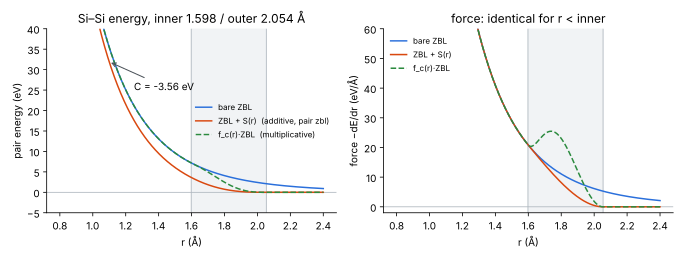

*그림 1. Si–Si(inner 1.598, outer 2.054 Å, 학습 스크립트 값). 왼쪽: 에너지. 덧셈형(주황)은 inner 안쪽에서 bare ZBL(파랑)보다 C = −3.56 eV 아래에 평행하게 놓인다. 곱셈형 f_c·ZBL(초록 점선)은 inner 안쪽에서 bare ZBL과 같다. 오른쪽: force. 덧셈형과 곱셈형 모두 inner 안쪽에서는 ZBL force와 같다. 곱셈형은 전이 구간에서 f_c′·E 항 때문에 ZBL보다 큰 bump가 생긴다.*

학습에 쓰는 cutoff(`generate_trainset/iter_learn/04_train/02_ZBL/get_residual_new_parallel.py`)로 계산한 $C$:

| pair | inner (Å) | outer (Å) | $E_{ZBL}(r_1)$ (eV) | $C$ (eV) | $F_{ZBL}(r_c)$ (eV/Å) |
|---|---|---|---|---|---|
| Si–Si | 1.598 | 2.054 | 7.19 | −3.56 | 5.27 |
| Si–F | 1.145 | 1.472 | 22.50 | −12.56 | 23.74 |
| Si–C | 1.208 | 1.553 | 13.80 | −7.68 | 13.79 |
| Si–H | 1.079 | 1.388 | 5.39 | −3.24 | 5.99 |
| C–F | 0.908 | 1.168 | 28.57 | −17.42 | 37.64 |
| F–F | 0.997 | 1.282 | 27.83 | −16.40 | 33.69 |
| H–H | 0.525 | 0.675 | 5.30 | −3.83 | 10.75 |

$C$는 몇 eV에서 십수 eV로, **무시할 수 있는 크기가 아니다.**

---

## 4. 질문 (2): ZBL이 잘 맞는 구간과 아닌 구간

### 4.1 세 구간

| 구간 | 대략적 범위 | 지배하는 물리 | 누가 맡아야 하나 |
|---|---|---|---|
| ① 단거리(충돌 core) | r ≲ 0.5 r_eq, 수십 eV 이상 (대부분 pair에서 r ≲ 1 Å, H 포함 pair는 더 짧음) | 핵-핵 쿨롱 + core 전자 반발. 화학결합 효과는 상대적으로 무시할 만함 | **ZBL** (또는 DFT dimer fit) |
| ② 중간 영역 | 대략 0.5–0.9 r_eq, 수 eV ~ 수십 eV | 반발과 결합 효과가 경쟁. 환경 의존성 큼 | **DFT 데이터로 학습한 포텐셜** (ZBL만으로도, 평형 포텐셜만으로도 부정확) |
| ③ 평형 근처 | r ≳ 0.9 r_eq | 화학결합 | 원래 포텐셜/MLIP. **ZBL은 꺼져 있어야 함** |

### 4.2 경계를 정하는 기준

1. **DFT dimer와의 오차**(§2): 상대오차가 허용치(예: 5–10%) 안에 드는 r을 ZBL의 "신뢰 구간"으로 잡는다.
2. **에너지 스케일**: 결합 에너지가 수 eV이므로, 상호작용 에너지가 그보다 한 자릿수 이상 큰 구간에서는 결합 효과가 오차에 미치는 비중이 작다.
3. **시뮬레이션에서 실제로 도달하는 거리**: 정면충돌의 최근접 거리 $r_{min}$은 $V(r_{min})=E_{cm}$(질량중심 에너지)로 정해진다. 아래는 ZBL로 계산한 $r_{min}$이다.

| pair | $E_{cm}$ = 10 eV | 30 eV | 100 eV | 300 eV | 1000 eV |
|---|---|---|---|---|---|
| Si–Si | 1.49 Å | 1.15 | 0.83 | 0.59 | 0.38 |
| Si–F | 1.40 | 1.06 | 0.75 | 0.52 | 0.32 |
| C–F | 1.22 | 0.90 | 0.60 | 0.40 | 0.23 |

   (실험실 에너지는 $E_{lab}=E_{cm}(M_1+M_2)/M_2$. 비정면 충돌은 $r_{min}$이 더 크다.)
   수백 eV 이온이라면 ① 구간까지 확실히 들어가고, **10–30 eV의 2차 충돌(cascade)은 대부분 ② 구간에서 일어난다.** 식각처럼 저에너지 반응이 중요한 문제에서는 ② 구간을 DFT로 잘 학습하는 것이 결과를 좌우한다.

4. **MLIP 학습 데이터 분포**: 각 pair의 최소 거리 히스토그램을 그려 본다. 데이터가 끊기는 거리보다 안쪽은 MLIP가 extrapolation하는 구간이다. 그 구간에서는 ZBL이 완전히 켜져 있어야 한다($r_1$ ≳ 데이터가 희박해지는 거리).
5. **평형 구조 보호**: $r_c$(outer)는 평형·열진동·압축 구조에서 나타나는 최소 결합 거리보다 작아야 한다. 이 저장소의 값은 결합 길이의 약 85–87%다.

---

## 5. 질문 (3): hybrid 방식으로 어떻게 이어 붙이나? constant shift가 생기나?

### 5.1 덧셈형: $E = E_{other} + \sum_{pairs}[V_{ZBL}(r)+S(r)]$

- LAMMPS `pair_style hybrid/overlay <other> zbl ...`, 이 저장소의 `hybrid/overlay nn/intel zbl/pair`가 이 방식이다.
- 다른 포텐셜은 그대로 두고, switching된 ZBL을 **더한다.**
- **constant shift가 생긴다.** inner 안쪽에서 pair 에너지가 $V_{ZBL}+C$다(§3).
- 장점: inner 안쪽의 force가 ZBL과 정확히 같고, 기존 포텐셜 코드를 건드리지 않는다.
- 단점: 다른 포텐셜이 짧은 거리에서 내는 에너지·force가 **그대로 남는다.** 그래서 ZBL을 더해도 그 오차가 같이 들어간다. NNP라면 descriptor 포화로 짧은 거리 force가 작게 나오는 편이지만 보장은 없다.

### 5.2 곱셈형(보간): $V = (1-f)\,V_{ZBL} + f\,V_{other}$

- LAMMPS `tersoff/zbl`:

$$
V_{ij}=(1-f_F(r_{ij}))V^{ZBL}(r_{ij})+f_F(r_{ij})V^{Tersoff}(r_{ij}),\qquad
f_F(r)=\frac{1}{1+e^{-A_F(r-r_C)}}
$$

  $A_F$는 전이의 날카로움, $r_C$는 사실상 ZBL cutoff다.
- **constant shift가 없다.** $r\ll r_C$이면 $V\to V_{ZBL}$, $r\gg r_C$이면 $V\to V_{other}$로 각각의 원래 값에 수렴한다.
- 단점: force에 $f_F'(r)\,(V_{other}-V_{ZBL})$ 항이 생긴다. 두 포텐셜의 차이가 크면 전이 구간에 force의 bump나 dip이 생긴다. $A_F$를 너무 크게 하면 이 항이 커지고, 너무 작게 하면 두 포텐셜이 넓게 섞인다. Fermi 함수는 정확히 0/1이 되지 않으므로 아주 작은 섞임은 항상 남는다.
- MLIP에서는 NN 에너지가 원자별 합이라 pair마다 곱하기 어렵다. 그래서 보통 **ZBL에만 envelope를 곱하는** 변형을 쓴다: $E = E_{ML} + \sum f_c(r)V_{ZBL}(r)$, $f_c$는 $r<r_1$에서 1, $r>r_c$에서 0인 매끄러운 다항식. 이것도 shift가 없지만 전이 구간 force에 $f_c'V_{ZBL}$ bump가 생긴다(그림 1의 초록 점선).

### 5.3 비교

| | 덧셈형 S(r) (`pair zbl`) | 곱셈형 f_c·ZBL | Fermi 보간 (`tersoff/zbl`) |
|---|---|---|---|
| r < inner 에너지 | ZBL + **C** | ZBL | ≈ ZBL |
| r < inner force | ZBL | ZBL | ≈ ZBL (+작은 섞임) |
| 전이 구간 force | ZBL보다 **작음** (일이 빠짐 → C) | ZBL보다 **큼** (f_c′·E bump) | f′·(V_other − V_ZBL) 항 |
| 연속성 | outer에서 $C^2$ | 다항식 차수에 따라 $C^1$/$C^2$ | $C^\infty$ (단 정확히 0이 되지 않음) |
| 다른 포텐셜 단거리 값 | 그대로 더해짐 | 그대로 더해짐 | (1−f)로 억제됨 |

**요약하면:** constant shift는 "덧셈형 + inner 안쪽 force 보존"을 택했을 때 생기는 수학적 귀결이다. 곱셈형을 쓰면 shift는 없지만 그 대신 전이 구간 force가 ZBL보다 커진다. 어느 쪽도 공짜는 아니다. 전이 구간에서 "빠진 일"이 shift로 나타나거나, "더해진 일"이 bump로 나타날 뿐이다.

---

## 6. 질문 (4): 잘못된 이어붙이기가 있나? (NVE 보존)

### 6.1 NVE 보존의 조건

Velocity Verlet처럼 symplectic한 적분기로 에너지가 (오차 범위 내에서) 보존되려면 다음이 필요하다.

1. **force가 정확히 −∇E**(보고하는 그 에너지의 gradient)일 것. 그렇지 않으면 보고되는 에너지가 보존되지 않는다.
2. **E가 위치만의 함수**일 것. 속도·시간·이력(어떤 원자가 "에너지가 높았는지" 등)에 의존하면 계가 conservative하지 않다.
3. **E가 연속($C^0$)**이고, 실용적으로는 **force도 연속($C^1$)**일 것. 불연속이 있으면 cutoff를 넘는 순간 에너지가 튀거나 적분 오차가 크게 생긴다.
4. **dt가 force 변화 속도에 비해 충분히 작을 것.** 위 조건을 다 만족해도 dt가 크면 에너지가 출렁이고 drift한다.

### 6.2 1D 충돌 실험

Si–Si 정면충돌($E_{cm}$ = 30 eV, dt = 1 fs, velocity Verlet)을 다섯 가지 결합 방식으로 돌려서 총에너지 $E_{tot}$의 변화를 봤다.

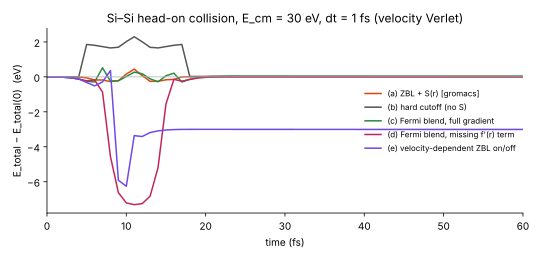

| 방식 | 충돌 중 최대 \|ΔE\| | 충돌 후 ΔE | 판정 |
|---|---|---|---|
| (a) ZBL + S(r) (gromacs) | 0.44 eV | +0.011 eV | 정상. 충돌 순간의 출렁임은 dt 오차이고 돌아온다 |
| (b) hard cutoff (S 없음) | 2.29 eV | +0.023 eV | **불량.** cutoff를 넘을 때 $V_{ZBL}(r_c)$만큼 에너지가 점프한다. 고립 dimer라 들어갈 때와 나올 때가 상쇄됐을 뿐이고, 다체계에서는 이런 점프가 쌓여 drift가 된다 |
| (c) Fermi 보간, gradient 완전 | 0.52 eV | +0.038 eV | 정상 |
| (d) Fermi 보간, $f'$ 항 누락 | **7.31 eV** | −0.011 eV | **불량.** force가 보고하는 에너지의 gradient가 아니다. 이 1D pair 예에서는 force가 여전히 r만의 함수라서 "다른 어떤 포텐셜"에 대해서는 conservative하고, 그래서 끝에서 값이 돌아왔다. 가중치가 배위수 같은 다체 변수에 의존하면 진짜로 비보존이 된다 |
| (e) 속도에 따라 ZBL on/off | 6.26 eV | **−3.01 eV** | **불량.** 포텐셜이 속도에 의존하므로 에너지가 영구적으로 사라진다 |

### 6.3 "틀린" 방법 정리

- **Hard cutoff / 불연속 switching**: 에너지가 점프한다. `pair_style zbl`이 switching을 내장하고 `pair_modify shift`를 지원하지 않는 이유가 이것이다(문서: *"the ZBL interaction is already smoothed to 0.0 at the cutoff"*).
- **force만 switching하고 에너지는 그대로 보고**(또는 반대): force와 에너지가 불일치하므로 보고되는 에너지가 보존되지 않는다.
- **곱셈형 가중치의 미분을 빠뜨림**: $f$가 r에 의존하면 $f'(V_{other}-V_{ZBL})$ 항이 필요하다. 가중치가 이웃 원자 위치에 의존(배위수 기반 switching 등)하면 그 이웃에 대한 force 항도 모두 넣어야 한다.
- **운동에너지·시간·이력 기반 on/off**: "빠른 원자에만 ZBL 적용", "처음 N step만 ZBL" 같은 방식이다. NVE가 깨진다.
- **학습 때와 MD 때 다른 ZBL**: NVE는 보존되지만 **물리가 틀린다.** 학습할 때 뺀 $C$·switching 형태와 MD에서 더하는 것이 다르면 NN이 보정하는 양과 실제 더해지는 양이 어긋난다.
- **`hybrid`(overlay가 아님)로 pair를 배타적으로 할당**: MLIP는 다체 포텐셜이라 pair 단위로 끄고 켤 수 없다. ZBL은 `hybrid/overlay`로 더해야 한다.

### 6.4 형식적으로는 맞지만 위험한 경우: 너무 좁은 switching 구간

S(r)는 구간 폭 $r_c-r_1$이 좁을수록 전이 구간의 force 기울기(곡률)가 커진다. N–N 정면충돌에서 한 번 충돌한 뒤 남는 $|\Delta E|$:

| N–N 설정 | $E_{cm}$ | dt = 1.0 fs | 0.5 fs | 0.2 fs | 0.1 fs |
|---|---|---|---|---|---|
| bare ZBL | 30 eV | 0.19 | 0.043 | 0.007 | 0.002 |
| 넓은 구간 0.78/1.00 Å | 30 eV | 0.57 | 0.48 | 0.016 | 0.003 |
| 좁은 구간 0.95/1.00 Å | 30 eV | 0.57 | 2.01 | **0.84** | 0.098 |
| bare ZBL | 100 eV | 11.2 | 0.22 | 0.023 | 0.006 |
| 넓은 구간 | 100 eV | 26.4 | 6.0 | 0.0005 | 0.008 |
| 좁은 구간 | 100 eV | 19.9 | 9.4 | **1.47** | 0.064 |

(단위 eV)

- 같은 dt에서 좁은 구간이 오차가 훨씬 크다(30 eV, 0.2 fs: 0.016 → 0.84 eV).
- 수십 eV 이상의 충돌에는 구간 폭과 무관하게 **dt ≲ 0.1–0.2 fs**가 필요하다. LAMMPS에서는 `fix dt/reset`으로 최대 변위를 제한하는 가변 dt를 흔히 쓴다.
- MLIP와 결합할 때는 좁은 구간이 residual도 날카롭게 만든다(질문 6).

---

## 7. 질문 (5): constant shift가 있는 ZBL이어도 괜찮은 이유

### 7.1 괜찮은 부분

- **inner 안쪽의 force는 bare ZBL과 똑같다.** 충돌 core에서 원자를 튕겨 내는 힘은 정확하다.
- 이 shift는 계 전체의 상수가 아니라 **pair 함수의 일부**다. $V_{ZBL}(r)+S(r)$는 모든 r에서 $C^2$로 매끄러운 하나의 pair potential이다. pair가 inner를 넘나들 때 에너지 점프가 없으므로 NVE와 아무 충돌이 없다.
- 이 함수에서 유도한 force가 dynamics를 정하고, 보고되는 에너지와도 일치한다.

### 7.2 공짜는 아닌 부분

$$
C=-\Big[\,V_{ZBL}(r_c)+\int_{r_1}^{r_c}\big(F_{ZBL}(r)-F_{sw}(r)\big)\,dr\Big]
$$

($F=-dE/dr$, $F_{sw}$는 ZBL+S의 force.) 즉 $|C|$는 **outer 바깥으로 잘려 나간 ZBL 꼬리 에너지 $V_{ZBL}(r_c)$**와 **전이 구간에서 force를 줄이면서 빠진 일(work)**을 합한 값이다. Si–Si 예에서는 $V_{ZBL}(r_c)$ ≈ 2.10 eV, 빠진 일 ≈ 1.46 eV로 합이 3.56 eV다. 그래서 ZBL+S만 단독으로 쓰면, 무한히 먼 곳에서 inner 안쪽까지 들어오는 데 필요한 에너지가 bare ZBL보다 $|C|$만큼 작다. 충돌의 최근접 거리가 달라진다:

| pair | $E_{cm}$ | $r_{min}$ (bare ZBL) | $r_{min}$ (ZBL+S) |
|---|---|---|---|
| Si–Si | 10 eV | 1.49 Å | 1.39 Å |
| Si–F | 10 eV | 1.40 | 1.14 |
| C–F | 10 eV | 1.22 | 0.92 |
| C–F | 100 eV | 0.60 | 0.57 |
| C–F | 1000 eV | 0.23 | 0.23 |

- 고에너지(≳ 수백 eV)에서는 $|C|$가 상대적으로 작아서 차이가 무시할 만하다.
- **저에너지(수~수십 eV)에서는 차이가 크다.** 이 영역이 식각 반응에서 중요하다.

### 7.3 그래서 왜 괜찮은가 → 다른 항이 $C$를 복원하기 때문

- **Delta learning(이 저장소 방식)**: NN이 $E_{ref}-E_{ZBL+S}$를 학습하므로, NN 출력에 "가까운 pair당 대략 $-C$"가 들어간다. 전체 모델 $E_{NN}+E_{ZBL+S}\approx E_{ref}$가 되어 $C$는 상쇄된다. 남는 것은 NN이 그 residual을 얼마나 잘 표현하느냐(§8)다.
- **Tersoff 등에 ZBL을 그냥 overlay**(재fit 없이): 아무도 $C$를 복원하지 않는다. 저에너지 충돌의 반발 장벽이 $|C|$만큼 낮아진다. 이런 경우에는 shift 없는 곱셈형을 쓰거나, 포텐셜을 재fit하는 것이 맞다.

**결론:** "collision force만 필요하니 shift는 상관없다"는 inner 안쪽 force에 대해서는 맞다. 하지만 충돌 궤적(최근접 거리, 산란각, 에너지 전달)은 force를 경로를 따라 적분한 에너지로 정해진다. 그래서 **전체 에너지 곡선이 reference를 따라가야** 한다. delta learning을 하면 이 조건이 자동으로 만족된다. 이것이 shift된 ZBL을 써도 괜찮은 진짜 이유다.

---

## 8. 질문 (6): reference − ZBL을 학습하는 전략은 괜찮은가

### 8.1 표준적인 전략이다

$$
E_{model}=E_{ZBL+S}+E_{ML},\qquad E_{ML}\ \text{은}\ E_{ref}-E_{ZBL+S}\ \text{(force, stress도 동일)를 학습}
$$

- GAP(Byggmästar et al. 등 방사선 손상 포텐셜): pair repulsion baseline 위에 GAP를 학습한다.
- DeePMD-kit: `use_srtab`으로 단거리 pair 테이블을 넣고, 그 위에 NN을 학습한다.
- ACE, MACE, NequIP 계열에도 ZBL/core repulsion baseline 옵션이 있다.

### 8.2 장점

- NN이 수십~수백 eV의 가파른 반발을 직접 배우지 않아도 된다. residual은 크기가 훨씬 작고 완만하다.
- 데이터가 없는 아주 짧은 거리에서도 ZBL이 지배하므로 원자가 서로 뚫고 지나가지 않는다.
- 이 저장소는 학습할 때 residual을 **같은 LAMMPS `zbl/pair`로** 계산해서 빼므로(E, F, S 모두) 학습과 MD 사이의 일관성이 확보되어 있다.

### 8.3 성공 조건과 체크리스트

1. **일관성**: MD의 `pair_coeff` inner/outer가 학습 때 쓴 `cutoff_dict`와 같아야 한다. 이 저장소에서는 `etc/nnp_neb/*_footer.in`의 값(SiSi 1.94/2.05 등)이 학습 스크립트(SiSi 1.598/2.054)와 다르다. 같은 potential이라면 맞춰야 한다.
2. **residual의 매끄러움**: 전이 구간 폭이 넓을수록 좋다. 좁으면 residual에 ZBL force만큼의 급격한 계단이 생기고, 매끄러운 descriptor를 쓰는 NN은 이를 잘 못 맞춘다. 결합 길이의 약 0.78 → 1.0배 정도인 학습 스크립트 쪽 비율이 무난하다.
3. **단거리 데이터**: 중간 영역(②)의 DFT 데이터(dimer scan, 압축 구조, 충돌 snapshot)가 있어야 NN이 ZBL과 DFT의 차이를 배운다.
4. **inner 안쪽에서 NN의 거동**: inner 안쪽의 residual은 "pair당 $-C$ + (DFT−ZBL 오차)"로 대략 일정하다. NN은 그 근처를 extrapolation한다. dimer/trimer scan으로 $F_{NN}$이 $F_{ZBL}$에 비해 작은지 확인한다.
5. **loss weighting**: 충돌 구조의 force는 크므로 force loss가 그 구조에 끌려가지 않도록 가중치나 force clipping을 점검한다.

---

## 9. 질문 (7): reference가 DFT가 아니라 MLIP이고, 차이가 점점 벌어지면?

### 9.1 먼저 구분할 것

- **constant shift $C$는 "ZBL+S vs bare ZBL"의 관계**다. reference와는 무관하게 S(r)만으로 정해진다.
- **"reference − ZBL"은 처음부터 상수가 아니다.** DFT라도 r에 따라 변한다. 다만 신뢰할 만한 reference라면 짧은 거리로 갈수록 ZBL에 **수렴**(상대오차 감소)하고, MLIP처럼 단거리 데이터가 없는 reference는 **발산**(softening, 가짜 인력)하는 경향이 있다.

### 9.2 그림으로 보면

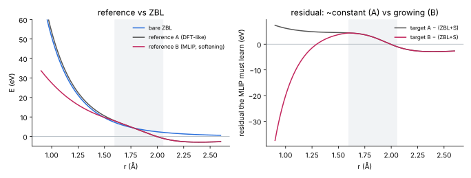

*그림 3. 가상의 두 reference. A(DFT형)는 짧은 거리에서 ZBL보다 약 5% 높게 따라가고, residual(오른쪽)은 inner 안쪽에서 거의 일정하다. B(MLIP형, softening)는 1.6 Å 아래에서 ZBL보다 점점 낮아지고, residual이 짧은 거리에서 −30 eV 이상으로 계속 커진다.*

### 9.3 switching 전략은 여전히 유효한가?

- **수학적으로는 유효하다.** ZBL+S는 reference와 무관하게 매끄럽고 보존적인 pair potential이다.
- **문제는 delta learning이 reference를 그대로 재현한다는 점이다.** reference B의 데이터를 inner 안쪽까지 학습하면 NN이 "−30 eV짜리 residual"을 배운다. 그러면 전체 모델 = ZBL + S + NN ≈ reference B가 되어 **ZBL을 넣은 의미가 사라진다.** reference가 틀린 곳에서는 모델도 틀린다.
- 게다가 residual이 크고 가파르면 NN이 잘 맞추지도 못한다. 그 결과 ZBL도 reference도 아닌 어중간한 곡선이 나온다.

### 9.4 어떻게 해야 하나

1. **reference의 신뢰 거리 $r_{trust}$를 정한다.** 소수의 DFT dimer/충돌 계산과 비교해서 reference가 어디서부터 틀어지는지 확인한다.
2. **$r_{trust}$보다 짧은 pair가 있는 구조는 학습에서 빼거나 가중치를 크게 낮춘다.** 그 구간은 ZBL이 맡는다.
3. **$r_1$(inner)을 $r_{trust}$ 근처 또는 바깥에 둔다.** reference가 틀리기 시작하는 거리에서는 ZBL이 이미 완전히 켜져 있어야 한다.
4. 가능하면 **단거리만이라도 DFT 데이터를 섞는다.** 소량의 dimer/trimer scan만으로도 효과가 크다.
5. 검증: dimer scan과 저에너지 충돌 궤적을 DFT와 비교한다. 최근접 거리, 에너지 손실, 반사/흡착 여부를 본다.

**결론:** 차이가 점점 벌어지는 reference라도 switching function 자체는 문제가 없다. 하지만 **"벌어지는 구간의 reference 데이터를 학습하지 않는다"**는 조건을 지켜야 전략이 성립한다. delta learning은 "reference가 옳다"는 가정 위에서만 옳은 결과를 준다.

---

## 10. 이 저장소에 적용한 정리

- `zbl/pair` = LAMMPS `pair zbl`과 같은 식 + pair별 inner/outer. pair별 cutoff는 물리적으로 문제없다. LAMMPS가 global 값을 쓰는 것은 구현상의 단순화다.
- 학습(`get_residual_new_parallel.py`)과 MD가 같은 바이너리와 같은 함수를 쓰므로 $C$는 NN이 흡수한다. 따라서 shift는 문제가 아니다.
- 확인할 것:
  - MD 입력의 `pair_coeff` inner/outer = 학습 때의 `cutoff_dict`인지(`etc/nnp_neb`는 다름).
  - 전이 구간을 충분히 넓게 유지할 것(현재 학습 값 비율 ≈ 0.78은 무난).
  - 충돌 MD의 dt(≲ 0.1–0.2 fs 또는 `fix dt/reset`).
  - dimer scan으로 NN+ZBL과 DFT를 비교(특히 ② 구간).
- 코드 메모: `write_restart`가 inner/outer를 저장하지 않으므로 restart 파일에서 이어 돌리면 값이 틀어진다.

---

## 11. 2부 (MLIP 쪽에서 본 ZBL hybrid) 요약

| 질문 | 짧은 답 |
|---|---|
| hybrid에서 MLIP는 inner 안쪽에서도 켜져 있나? | 그렇다. `zbl/pair`는 ZBL만 계산하고 NN은 `hybrid/overlay`로 따로 더해진다. delta learning에서는 NN이 inner 안쪽에서 −C를 채워 주므로 **켜져 있어야** 맞다. |
| PES softening은 데이터 탓인가, 구조 탓인가? | 주원인은 데이터 분포(평형 근처 구조가 대부분)다. 구조는 "데이터가 없는 곳에서 가파르게 올라갈 이유가 없다"는 쪽으로 작용해서 softening을 막지 못한다. 13장. |
| tanh면 왜 atomic energy 상한이 생기나? | 출력층이 선형이고 마지막 hidden layer가 tanh이면 $E_i=b+\sum_k w_k h_k$, $\lvert h_k\rvert<1$이므로 $\lvert E_i-b\rvert<\sum_k\lvert w_k\rvert$이다. 입력이 무엇이든 성립한다. 14장. |
| radial / angular force를 왜 나누나? 합치면 total인가? | chain rule로 $F=-\sum_\mu(\partial E/\partial G_\mu)(\partial G_\mu/\partial x)$이고, μ를 G2 묶음과 G4/G5 묶음으로 나눈 것뿐이다. 둘을 더하면 정확히 total이다. 나누는 이유는 r→0 거동이 다르기 때문이다(G2: ∝r→0, angular: ≲1/r). 15장. |
| 이걸 다들 알고 있나? | 재료(유계 활성화 함수, ACSF 미분식)는 교과서적이다. 하지만 "그래서 BPNN은 r→0에서 폭발하지 않는다"를 식으로 정리한 문헌은 내가 아는 한 없다. 보통 반대쪽 표현인 "NNP는 짧은 거리에서 평평해져서 원자가 뚫고 지나간다"로 알려져 있다. 16장. |
| switching을 영리하게 한 사람은? | atom 단위 가중치를 매끄러운 원자 변수(softmin 거리)로 만드는 방법(DeePMD의 DP/ZBL)이 있고, **연구실 SevenNet checkpoint가 바로 이 방식**이다. 대가로 $-E_i^{ML}\nabla f_i$ 항이 생기고, 실측하면 spectator에 ~54 eV/Å이다. bond(edge) 단위로 끄는 방법이 이 항을 피한다. 17장. |
| U-MLIP에서 spectator force가 튀는 이유? 수렴값을 미리 계산할 수 있나? | message passing은 충돌한 edge의 정보를 이웃 원자로 전달한다. Bessel basis는 r→0에서 유한값으로 수렴하고 기울기는 0이므로 dimer 에너지는 유한값으로 수렴한다. SevenNet Si–Si는 1948.8 eV다. 계산할 수 있고, 모델을 r≈10⁻³ Å에서 평가하면 된다. 18장. |

---

## 12. hybrid ZBL + MLIP에서 MLIP는 inner 안쪽에서도 켜져 있다

- `lammps/pair_zbl_p.cpp`는 ZBL+S만 계산한다. NN(`nn/intel`)은 `pair_style hybrid/overlay nn/intel zbl/pair`로 따로 계산되어 더해진다. 그래서 NN은 모든 거리에서 켜져 있다.
- delta learning에서는 이것이 맞다. inner 안쪽 residual은 $E_{DFT}-(V_{ZBL}+C)\approx -C+(\text{작은 DFT−ZBL 차})$이고, 이 $-C$를 NN이 채운다. NN을 끄면 $C$가 보상되지 않는다(7장).
- 걱정해야 할 것은 "NN이 켜져 있다는 사실"이 아니다. **켜져 있는 NN이 거기서 어떤 값을 내느냐**다. 이 저장소의 BPNN에서는 그 값이 유한하다는 것이 수학적으로 보장된다(14–15장). 실제로 확인해야 하는 곳은 0.5–1.5 Å의 중간 구간이다(15.5).

---

## 13. PES softening: 데이터 탓인가, 구조(activation/basis) 탓인가

**주원인은 데이터다.** U-MLIP가 학습하는 재료 DB(예: Materials Project relaxation trajectory)는 대부분 평형 근처 구조다. 이 편향 때문에 표면·결함·phonon·이동 장벽처럼 평형에서 벗어난 영역에서 에너지와 곡률을 **체계적으로 과소평가**한다는 것이 Deng et al.의 보고다. 이들은 off-equilibrium 데이터를 조금만 추가해 fine-tuning해도 상당 부분 고쳐진다고 했다. "softening"이라는 말도 이 논문에서 정착했다.

**구조의 역할은 "막지 못한다"는 쪽이다.**

- 손실함수는 데이터가 있는 곳에서만 기울기를 요구한다. 데이터가 희박한 곳에서는 regularization, early stopping, 매끄러운 basis 같은 귀납 편향이 함수를 "작고 매끄러운" 쪽으로 당긴다. 그래서 가파른 벽은 덜 가파르게 학습된다.
- 데이터가 아예 없는 곳(r≪1 Å)에서는 가파르게 올라가라고 요구하는 항이 손실에 전혀 없다. radial basis가 유한값으로 수렴하므로(18.2), $1/r$처럼 발산하는 함수는 구조적으로 나올 수 없다.
- 즉, **데이터가 얼마나 가파른지 알려 주지 않는 곳에서 구조는 가파름을 만들어 내지 않는다.** 그 결과가 "증가는 하지만 가파르지 않은" 곡선이다.

연구실 SevenNet checkpoint의 raw ML 부분(switch를 끄고 본 값)을 실측했다. Si–Si는 1.0–1.3 Å에서 bare ZBL과 거의 겹친다. 하지만 0.6 Å에서는 66 eV로 ZBL(278 eV)의 1/4이다. 데이터가 있는 거리까지는 맞고, 그 아래부터 무른 것이다.

<!-- demo:soft -->

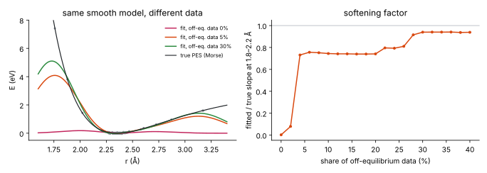

*그림 2-1. 같은 매끄러운 모델(Gaussian RBF ridge 회귀)에 평형 근처 데이터와 off-equilibrium 데이터를 섞어 Morse PES를 fit했다. off-equilibrium 비율이 작을수록 반발 벽의 기울기를 과소평가한다(0% → 거의 평평, 5% → 약 0.75배, 30% 이상 → 약 0.94배). HTML 버전에서는 비율, regularization, 평형 근처 분포 폭을 바꿔 볼 수 있다.*

---

## 14. tanh면 왜 atomic energy에 상한이 생기나

### 14.1 식

이 저장소의 SIMPLE-NN potential은 원소마다 `182 → (linear PCA 182) → tanh 60 → tanh 60 → linear 1` 구조다(`pot/simplenn/*` 파일의 `NET 3 182 60 60 1`, `LAYER … tanh`). 정확히 말하면 "마지막 layer가 tanh"가 아니라 **마지막 hidden layer가 tanh이고 출력층은 선형**이다.

$$
E_i = b + \sum_{k=1}^{60} w_k\,h_k,\qquad h_k=\tanh(a_k),\quad a_k=\text{(앞 layer들의 임의의 함수)}
$$

$\tanh$의 치역이 $(-1,1)$이므로 $a_k$가 무엇이든 $\lvert h_k\rvert<1$이다. 삼각부등식을 쓰면

$$
\lvert E_i-b\rvert=\Big\lvert\sum_k w_k h_k\Big\rvert\le\sum_k\lvert w_k\rvert\,\lvert h_k\rvert<\sum_k\lvert w_k\rvert\equiv S_i .
$$

이 부등식에는 입력 $G$가 전혀 들어가지 않는다. **descriptor가 학습 범위를 아무리 벗어나도** $E_i\in(b-S_i,\;b+S_i)$다. 원자 하나가 충돌로 바꿀 수 있는 NN 에너지는 $2S_i$보다 작고, 충돌 쌍 전체의 NN 에너지 변화도 $2(S_A+S_B)$보다 작다. 반면 ZBL은 $Z_AZ_Be^2/r$로 발산하므로, 충분히 짧은 거리에서는 반드시 ZBL이 이긴다.

pot 파일에서 직접 읽은 값:

| potential | Si | N / O | C | H | F |
|---|---|---|---|---|---|
| Si3N4: $b$, $S$ (eV) | −1.52, 11.30 | N: −0.97, 13.80 | −2.04, 18.68 | 1.51, 11.70 | −4.01, 11.79 |
| SiO2: $b$, $S$ (eV) | −1.62, 8.29 | O: −0.91, 12.50 | −1.93, 16.53 | 1.56, 11.80 | −3.97, 13.00 |

이 값은 모든 hidden unit이 부호를 맞춰 포화할 때만 도달하는 최악의 경우다. 실제 dimer에서 본 변화폭은 수~20 eV 정도였다(15.5).

### 14.2 힘(기울기)의 상한

$$
\frac{\partial E_i}{\partial G}=W_1^{\top}\,\mathrm{diag}(1-h^{(1)2})\,W_2^{\top}\,\mathrm{diag}(1-h^{(2)2})\,w\quad\Rightarrow\quad
\Big\lVert\frac{\partial E_i}{\partial G}\Big\rVert\le\lVert W_1\rVert\,\lVert W_2\rVert\,\lVert w\rVert
$$

여기서 $0<1-\tanh^2\le1$이고, $W_1$은 PCA와 scaling을 접은 첫 layer다. 따라서 $\partial E/\partial G$도 입력과 무관하게 유계다. 학습 범위 밖에서 unit이 포화하면 $1-h^2\to0$이 되어 오히려 **작아진다**. 그러면 힘의 크기는 $\partial G/\partial x$가 결정한다(15장).

### 14.3 tanh가 아니면?

- ReLU/SiLU처럼 위로 열린 활성화 함수는 $E_i$를 입력에 대해 선형으로 키울 수 있다. 다만 ACSF 값 자체가 유계다(G2 각 항 ≤ 1, 이웃 수만큼의 합). 그래서 도달 가능한 입력 영역 위에서는 여전히 유계다. 대신 그 상한이 크고, 가중치 norm의 곱(Lipschitz 상수)에 따라 정해진다.
- 결론: "폭발하지 않는다"는 tanh뿐 아니라 **유계 descriptor + 연속 함수**라면 성립한다. tanh는 그 상한을 $\sum\lvert w\rvert$라는 작고 명시적인 값으로 만들어 준다.

### 14.4 실제 네트워크로 확인

SiO2 potential의 Si 네트워크에 SiO4 정사면체의 Si 환경을 넣고, Si–O 거리를 4 Å에서 0.05 Å까지 바꿨다.

<!-- demo:tanh -->

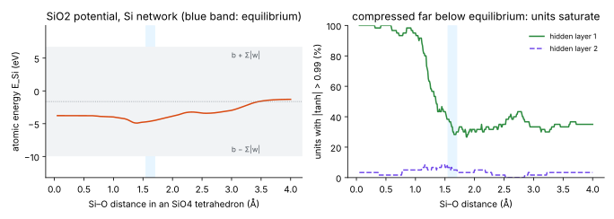

*그림 2-2. 왼쪽: $E_{Si}$는 tanh 한계(회색 띠) 안에 머물고, 0.8 Å 아래에서는 거의 상수다. 오른쪽: 평형(파란 띠)에서는 layer 1 unit의 약 30%만 포화하지만, 0.6 Å 아래에서는 거의 100% 포화한다. 포화하면 $\partial E/\partial G\to0$이 되어 NN의 힘이 사라진다. HTML 버전에서는 슬라이더로 거리를 바꾸며 120개 hidden unit의 값을 색으로 볼 수 있다.*

---

## 15. radial force와 angular force

### 15.1 둘은 더해서 total force가 된다

$$
\mathbf F_k=-\frac{\partial E}{\partial\mathbf x_k}=-\sum_i\sum_{\mu}\frac{\partial E_i}{\partial G_{i\mu}}\,\frac{\partial G_{i\mu}}{\partial\mathbf x_k}
=\underbrace{-\sum_i\sum_{\mu\in\text{G2}}(\cdots)}_{\mathbf F_k^{rad}}\;\underbrace{-\sum_i\sum_{\mu\in\text{G4,G5}}(\cdots)}_{\mathbf F_k^{ang}}
$$

chain rule의 합을 descriptor 종류별로 묶은 것일 뿐이므로 $\mathbf F=\mathbf F^{rad}+\mathbf F^{ang}$가 정확히 성립한다. `pair_nn.cpp`도 G2와 G4/G5의 미분을 따로 계산해서 같은 force 배열에 더한다. 나눠서 보는 이유는 **r→0 거동이 다르기 때문**이다.

### 15.2 radial: 곱의 미분에서 한쪽은 r이 나오고, 다른 쪽은 0이 된다

$$
G2(r)=e^{-\eta(r-R_s)^2}f_c(r),\qquad
\frac{dG2}{dr}=\underbrace{-2\eta(r-R_s)e^{-\eta(r-R_s)^2}f_c}_{\text{term 1}}+\underbrace{e^{-\eta(r-R_s)^2}f_c'(r)}_{\text{term 2}}
$$

$f_c(r)=\tfrac12[1+\cos(\pi r/r_c)]$이므로 $f_c'(r)=-\tfrac{\pi}{2r_c}\sin(\pi r/r_c)$이고, $f_c'(0)=0$이다.

- $R_s=0$(이 저장소의 모든 G2): term 1 $\approx-2\eta r\to0$, term 2 $\approx-\tfrac{\pi^2}{2r_c^2}r\to0$. **둘 다 r에 비례해서 0으로 간다.** 그래서 충돌하는 쌍의 radial force는 r→0에서 사라진다.
- $R_s>0$: term 1 → $2\eta R_s e^{-\eta R_s^2}$로 **유한하지만 0은 아니다**. 이 경우에도 유계라는 결론은 그대로다.

<!-- demo:g2 -->

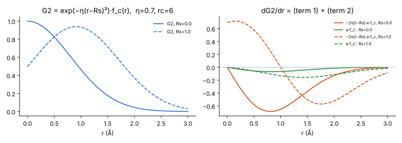

*그림 2-3. 실선 $R_s=0$, 점선 $R_s=1$. 오른쪽 그림이 두 항을 따로 보여 준다.*

### 15.3 angular: 값은 유계, 옆 방향 기울기는 ~1/r

$$
G4=2^{1-\zeta}\sum_{j<k}(1+\lambda\cos\theta_{jik})^{\zeta}\,e^{-\eta(r_{ij}^2+r_{ik}^2+r_{jk}^2)}f_c(r_{ij})f_c(r_{ik})f_c(r_{jk})
$$

$\cos\theta_{jik}$는 $\mathbf r_{ij}$의 **방향**에만 의존한다. 원자 j를 $\mathbf r_{ij}$에 수직으로 δ만큼 움직이면 각도가 $\delta/r_{ij}$만큼 바뀐다. 그래서

$$
\Big\lvert\frac{\partial\cos\theta_{jik}}{\partial\mathbf x_j}\Big\rvert=\frac{\sin\theta_{jik}}{r_{ij}}
$$

이고, G4의 수직 방향 기울기는 $\sim1/r_{ij}$로 커진다. $\mathbf r_{ij}$ 방향으로는 각도가 변하지 않으므로 유한하다. 결과적으로 NN의 angular force는 최대 $\sim C/r$이다(C는 14.2의 유계 계수). ZBL force는 $\sim Z_AZ_Be^2/r^2$이므로 r→0에서는 ZBL이 이긴다.

<!-- demo:angular -->

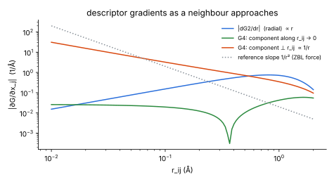

*그림 2-4. descriptor 수준의 기울기(log–log). radial ∝ r, angular 수직 성분 ∝ 1/r, ZBL force ∝ 1/r².*

### 15.4 실제 계산: F가 SiO4로 접근할 때 (SiO2 BPNN)

`simplenn_eval.py`로 G2/G4/G5 전체를 계산하고 force를 radial과 angular로 나눴다. F는 한 O의 반대쪽에서 20° 비껴서 접근한다.

| Si–F (Å) | 2.0 | 1.3 | 1.1 | 0.9 | 0.5 | 0.25 | 0.12 |
|---|---|---|---|---|---|---|---|
| $\lvert F_{NN}\rvert$ on F (eV/Å) | 7.1 | 13.5 | 17.7 | 11.9 | 2.1 | 17.0 | 16.1 |
| angular ⊥ 성분 | 3.0 | 4.2 | 7.0 | 3.6 | 10.3 | 12.5 | 15.4 |
| ZBL+S on F | 0 | 29 | 91 | 209 | 1800 | 14600 | 93000 |
| spectator O 최대 $\lvert F_{NN}\rvert$ | 5.7 | 9.8 | 15.0 | 15.7 | 10.5 | 8.5 | 5.1 |

- NN force는 모든 거리에서 ~20 eV/Å 이하로 유지된다. ZBL은 1/r²로 커진다.
- angular 수직 성분은 0.5 → 0.12 Å에서 10 → 15 eV/Å로 천천히 커진다. 15.3의 1/r 인자에 포화된 $\partial E/\partial G$가 곱해진 결과다.
- 충돌에 참여하지 않는 O 원자의 NN force도 유계다(≤16 eV/Å).

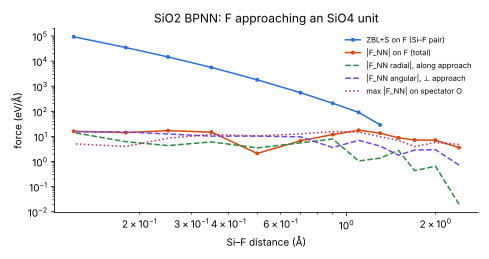

### 15.5 이 저장소 BPNN의 dimer: 진짜 확인할 곳은 중간 구간

<!-- demo:dimer -->

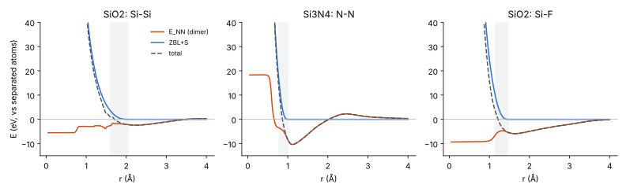

*그림 2-5. 진공 dimer의 NN 에너지(주황)는 r ≲ 0.8 Å에서 평평하다. ZBL+S(파랑)를 더한 총에너지(점선)는 단조 증가한다.*

r < inner 구간에서 $\max\lvert F_{NN}/F_{ZBL}\rvert$:

| potential | 대부분의 pair | 큰 경우 |
|---|---|---|
| Si3N4 | 0.03–0.35 | N–N 0.51 (0.60 Å: 228 vs 446 eV/Å), Si–Si 0.61 (1.40 Å) |
| SiO2 | 0.02–0.29 | **Si–Si 1.67** (1.50 Å: −48.7 vs +29.2 eV/Å, total force가 잠깐 인력) |

r→0의 안전은 보장된다. 확인해야 하는 것은 **중간 구간에서 NN이 extrapolation으로 내는 force가 ZBL보다 작은가**다. 진공 dimer는 가장 극단적인 extrapolation이므로, slab 충돌 경로로 한 번 더 확인하는 것이 좋다.

---

## 16. 이걸 다들 알고 있나?

- **재료는 교과서적이다.** 유계 활성화 함수 → 유계 출력은 신경망의 기본 성질이다. ACSF와 그 미분식은 Behler(2011)에 그대로 있다. "NNP는 짧은 거리를 학습하지 못하므로 ZBL 같은 pair 반발을 더해야 한다"도 방사선 손상·스퍼터링 MLIP 문헌에서 표준적인 인식이다.
- **하지만 결론까지 식으로 정리한 문헌은 내가 아는 한 없다.** 보통은 반대쪽 현상으로 알려져 있다. "NNP 에너지가 짧은 거리에서 평평해져서(plateau) 원자가 서로 뚫고 지나간다"는 것이다. 이것은 14–15장의 수학(포화 + $dG/dr\to0$)이 만드는 바로 그 현상이다. 같은 성질이 "ZBL 없이는 위험하다"로도, "ZBL을 더하면 안전하다"로도 읽힌다.
- 따라서 "Rs=0 G2와 tanh BPNN은 r→0에서 에너지가 유계이고, radial force가 0으로 가며, angular force는 O(1/r)이다. 그러므로 ZBL(∝1/r²)이 지배한다"는 짧은 명제는 논문이나 학위논문의 한 단락으로 충분히 쓸 수 있는 내용이다.

---

## 17. atom-wise vs bond-wise: switching을 영리하게 하는 방법

### 17.1 왜 정의가 어려운가

ZBL은 **pair(bond)** 단위 $V(r_{ij})$인데, BPNN/GNN 에너지는 **원자** 단위 $E_i$다. "가까운 쌍에서 ML을 끈다"를 쓰려면 원자 단위 가중치 $f_i$를 정의해야 하고, 그러면

$$
E=\sum_i f_i\,E_i^{ML}+\sum_{i<j}V_{ZBL}^{sw}(r_{ij}),\qquad
\mathbf F_k\supset-\sum_i E_i^{ML}\,\frac{\partial f_i}{\partial\mathbf x_k}
$$

라는 항이 생긴다. 이 항에는 두 가지 문제가 있다.

1. **$E_i^{ML}$의 기준(gauge)이 임의적이다.** 원자 에너지는 전체 합만 의미가 있다. 원자별 shift를 바꾸면 이 force가 바뀐다.
2. **$f_i$가 원자 i의 모든 이웃 위치에 의존한다.** 그래서 충돌하지 않는 이웃(spectator)에게도 force가 생긴다. 한 쌍이 가까워지면 원자 i의 다른 결합 에너지까지 함께 꺼지는 것도 같은 문제다.

### 17.2 해법 A: pair baseline + MLIP는 그대로 (이 저장소의 BPNN)

$f_i\equiv1$로 두고 ZBL+S를 더한 다음, residual을 학습한다. 위의 문제가 처음부터 없다. 대신 MLIP의 단거리 거동이 유계·평탄해야 한다(14–15장). BPNN은 이 조건을 구조적으로 만족한다.

### 17.3 해법 B: 매끄러운 atom-level 변수로 가중치 만들기 (DeePMD DP/ZBL, 연구실 SevenNet)

DeePMD-kit의 DP/ZBL 모델은 원자마다 이웃 거리의 softmin $\sigma_i$를 만들고, 그것으로 DP와 ZBL을 보간한다. **연구실 SevenNet checkpoint(`pot_7net_chg_tot_l3i3_zbl_a0.104.pt`)의 TorchScript 코드를 읽어 보면 같은 계열의 방식이 들어 있다.**

$$
\bar r_{ij}=\frac{r_{ij}}{s_{ij}},\quad s_{ij}=\frac{Z_i^{0.23}+Z_j^{0.23}}{0.4685},\qquad
\sigma_i=\frac{\sum_j c(\bar r_{ij})\,\bar r_{ij}\,e^{-\bar r_{ij}/\alpha}}{\sum_j c(\bar r_{ij})\,e^{-\bar r_{ij}/\alpha}},\quad\alpha=0.104
$$

$$
\tau_i=\frac{\sigma_i-0.069}{0.070},\qquad f_i=\tau^5(70\tau^4-315\tau^3+540\tau^2-420\tau+126)\ (0\le\tau\le1),\qquad E_i\leftarrow f_i\,E_i^{ML}
$$

- $c(\bar r)$는 $\bar r<0.139$에서 1이고 $\bar r_{max}=5/\max_Z s\approx0.407$에서 0이 되는 cutoff다.
- ZBL은 pair마다 같은 window($\bar r$ = 0.069–0.139, 즉 $r$ = 0.069·$s_{ij}$ – 0.139·$s_{ij}$)의 gromacs S(r)로 **더해진다**. Si–Si는 0.54–1.09 Å, Si–F는 0.51–1.04 Å, H–H는 0.30–0.59 Å이다.
- 파일 이름의 `a0.104`가 α다. 이 재구성은 dimer에서 모델 출력과 소수 넷째 자리까지 일치했다(`sevennet_scan.py`의 `f_atom`).

이 방식은 "atom-wise 가중치를 원자 환경의 매끄러운 함수로 만든다"는 점에서 영리하다. 에너지가 연속이고 gradient도 일관되어 NVE를 깨지 않는다. 하지만 17.1의 $-E_i^{ML}\nabla f_i$ 항은 그대로 남는다. 실제로 재 보면:

<!-- demo:softmin -->

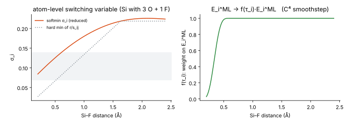

*그림 2-6. Si(O 3개는 1.61 Å에 고정) + 접근하는 F. 다른 이웃 때문에 softmin σ가 hard min보다 높게 유지되어, ML은 pair window(0.51–1.04 Å)보다 훨씬 안쪽(≲0.5 Å)에서야 꺼진다. HTML 버전에서는 α와 원자 에너지 기준(offset)을 바꿔서 −f′·E 항이 기준에 따라 어떻게 바뀌는지 볼 수 있다.*

<!-- demo:spill -->

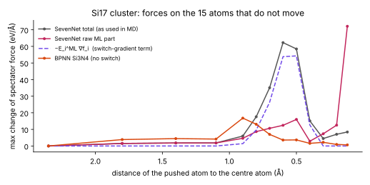

*그림 2-7. Si17 cluster(다이아몬드 1·2차 이웃)에서 한 원자를 중심 원자로 밀어 넣었을 때, 움직이지 않는 15개 원자의 force 변화.*

| 밀어 넣은 거리 (Å) | 1.1 | 0.8 | 0.7 | 0.6 | 0.5 | 0.4 | 0.2 | 0.12 |
|---|---|---|---|---|---|---|---|---|
| SevenNet total (MD에서 쓰는 값) | 1.8 | 17.6 | 35.1 | **62.3** | **58.5** | 15.1 | 7.1 | 8.4 |
| └ switch 항 $-E_i^{ML}\nabla f_i$ | 0 | 9.6 | 26.3 | 53.8 | 54.3 | 12.7 | 0 | 0 |
| SevenNet raw ML (switch 없이) | 1.8 | 8.7 | 10.6 | 12.5 | 16.0 | 2.9 | 12.5 | **72.1** |
| BPNN Si3N4 (switch 없음) | 4.2 | 13.1 | 7.0 | 3.6 | 3.7 | 1.6 | 0.9 | 0.7 |
| 중심 원자 $E_i^{ML}$ (eV) | 13 | 25 | 34 | 50 | 75 | 128 | 456 | 604 |

(단위 eV/Å, 15개 spectator 중 최대 $\lvert\Delta F\rvert$)

- 0.5–0.7 Å의 spectator force 피크는 **대부분 switch 항**이다. 이 거리에서 U-MLIP의 $E_i^{ML}$이 이미 30–80 eV로 커져 있어서, $\nabla f_i$에 곱해지는 값이 크다.
- switch가 없으면 raw ML 부분이 0.12 Å에서 spectator에 72 eV/Å를 준다. 이것은 switch가 잘 막고 있다(total 8 eV/Å).
- BPNN은 switch 없이도 spectator force가 전 구간에서 작다(≤13 eV/Å, r→0에서 감소).

### 17.4 해법 C: bond(edge) 단위로 끄기

가중치를 원자 에너지가 아니라 **descriptor/message의 edge 가중치**에 넣는 방법이다.

$$
\text{BPNN: } G_{i\mu}=\sum_j g_\mu(r_{ij})\,u(r_{ij})\,\big[1-s_{in}(r_{ij})\big],\qquad
\text{GNN: } m_{ij}=R(r_{ij})\,u(r_{ij})\,\big[1-s_{in}(r_{ij})\big]\,(\cdots)
$$

$s_{in}$은 inner 안쪽에서 1이 되는 매끄러운 함수다.

- 가까운 쌍은 MLIP 입장에서 **이웃이 아닌 것처럼** 보인다. 그 쌍의 에너지는 ZBL(pair)이 맡는다. pair 단위끼리 맞물리므로 17.1의 atom/bond 불일치가 사라진다.
- 추가되는 force는 $\partial s_{in}/\partial r_{ij}$를 통해 **i, j 두 원자에만** 걸린다. $E_i^{ML}$ 전체가 곱해지지 않으므로 gauge 문제도 없다.
- 대가: 재학습이 필요하다(descriptor가 바뀜). angular 함수에서는 $f_c(r_{ij})f_c(r_{ik})f_c(r_{jk})$ 각각에 inner 인자를 넣어야 한다. inner 안쪽에서는 MLIP가 "두 원자가 겹쳐 있지만 서로 모르는" 상태를 보게 된다. 이 상태의 에너지는 다른 이웃들과의 결합으로 정해지므로 대체로 합리적이다.
- ACE(pacemaker) 같은 일부 구현에는 radial basis에 inner cutoff를 두고 core repulsion으로 넘기는 옵션이 있는 것으로 알고 있다. 정확한 형태는 해당 문서를 확인하기 바란다.

### 17.5 비교

| | A: pair baseline (현재 BPNN) | B: atom-level softmin (DP/ZBL, 연구실 SevenNet) | C: edge-level inner cutoff |
|---|---|---|---|
| MLIP 단거리 거동 요구 | 유계·평탄해야 함 | 덜 중요 (꺼짐) | 덜 중요 (그 edge가 없음) |
| 추가 force 항 | 없음 | $-E_i^{ML}\nabla f_i$ → spectator 포함, gauge 의존 | $\partial s_{in}/\partial r_{ij}$ → i, j에만 |
| 다른 결합까지 꺼지나 | 아니오 | 예 (원자 i 전체) | 아니오 |
| 재학습 | residual 학습만 | 필요 | 필요 |
| 측정된 spectator 최대 $\lvert\Delta F\rvert$ | BPNN ≤13 eV/Å | 62 eV/Å (0.6 Å) | (미측정) |

B를 유지한다면 두 가지를 개선할 수 있다. 하나는 **$E_i^{ML}$을 고립 원자 에너지 기준으로 둔 뒤 $f_i$를 곱하는 것**($E_i^{ML}-E_i^{atom}$; switch 항의 gauge 의존을 줄인다)이다. 다른 하나는 **switch 구간에서 $E_i^{ML}$이 커지지 않도록 학습 데이터를 구성하는 것**이다.

---

## 18. message passing U-MLIP에서 spectator force가 튀는 이유, 그리고 수렴값

### 18.1 locality의 차이

- **BPNN:** $E_k$는 원자 k의 cutoff(6 Å) 안의 원자 위치에만 의존한다. 충돌 쌍(i, j)과 멀리 떨어진 spectator k의 force는 $-\partial E_i/\partial G_i\cdot\partial G_i/\partial\mathbf x_k$를 통해서만 영향을 받는다. 14.2의 상한 때문에 유계이고, 포화되면 작아진다. 진공 dimer에서 fit한 근사가 slab에서도 통했던 이유와 같다. 주변 원자 간 거리는 거의 변하지 않으므로 그들의 descriptor도 거의 변하지 않는다.
- **message passing (T층):** $h_i^{(t+1)}=\phi\big(h_i^{(t)},\sum_j R(r_{ij})\,Y(\hat r_{ij})\otimes h_j^{(t)}\big)$. 충돌한 edge (i, j)의 학습 범위 밖 입력이 $h_i$를 바꾸고, 그 변화가 다음 층에서 i의 이웃 k로 전달된다. 그러면 k의 force에 $R'(r_{ik})\,h_i$ 같은 항이 생긴다. $r_{ik}$는 변하지 않았는데 $h_i$가 커졌기 때문이다. receptive field는 $T\cdot r_c$(SevenNet 5 Å × 여러 층)이다. 출력 MLP와 filter는 SiLU처럼 위로 열린 함수이고, tensor product는 곱셈이므로 증폭될 수 있다.

### 18.2 radial basis(Bessel)는 유한값으로 수렴하고 기울기는 0이다

SevenNet checkpoint의 radial basis(TorchScript에서 확인):

$$
B_n(r)=0.4\,\frac{\sin(c_n r)}{r},\quad c_n=[0.48,\,1.08,\,1.70,\,2.36,\,3.02,\,3.72,\,4.42,\,5.14]\ \text{Å}^{-1}\ (\text{학습된 값}),\quad r_c=5\ \text{Å}
$$

envelope는 4.5–5 Å에서만 작동하는 XPLOR형이다.

$$
\frac{\sin(cr)}{r}=c-\frac{c^3r^2}{6}+\cdots\ \Rightarrow\ B_n(0)=0.4\,c_n,\quad B_n'(0)=0
$$

- **유한하다:** $B_n(0)$ = 0.19 – 2.06이다. 하지만 데이터 범위(r ≥ 1.5 Å)에서 본 최대값과 비교하면 n = 1에서 1.1배, n ≥ 6에서 7.8배다. 범위 밖 입력이다.
- **기울기가 0이다:** G2(Rs=0)와 같은 구조다. 충돌 edge의 radial 입력은 r→0에서 변하지 않게 된다.
- 방향 $Y_{lm}(\hat r)$은 angular ACSF처럼 수직 방향으로 ~1/r 기울기를 만든다.
- 수렴은 $r\ll1/c_{max}\approx0.2$ Å에서 일어난다. 그래서 0.3 Å과 0.01 Å 사이에서는 여전히 크게 변한다.

<!-- demo:bessel -->

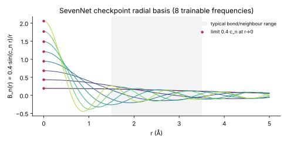

### 18.3 그래서 수렴값을 미리 계산할 수 있나? → 있다

dimer라면 방향이 고정되므로 모든 입력이 유한한 극한을 갖는다. 모델을 r ≈ 10⁻³ Å에서 평가하면 그것이 극한값이다. 실측(연구실 SevenNet, raw ML 부분, 분리된 원자 기준):

| pair | 0.3 Å | 0.1 Å | 0.03 Å | 0.01 Å | 10⁻³ Å | 3×10⁻⁴ Å |
|---|---|---|---|---|---|---|
| Si–Si | 655 | 1732 | 1928 | 1946 | 1948.8 | **1948.8** |
| Si–F | 140 | 296 | 333 | 336 | 336.8 | **336.8** |
| Si–O | 312 | 674 | 739 | 745 | 745.8 | **745.8** |
| C–F | 415 | 748 | 809 | 814 | 814.9 | **814.9** |
| N–N | 653 | 1504 | 1656 | 1670 | 1672.1 | **1672.1** |
| H–H | 6.5 | 18.5 | 20.8 | 21.0 | 21.1 | **21.1** |

(eV) 비교: bare ZBL Si–Si는 0.3 Å에서 1713 eV이고 r→0에서 발산한다.

<!-- demo:u7dimer -->

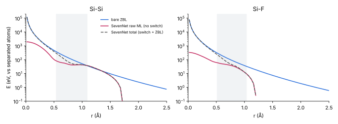

*그림 2-8. SevenNet raw ML(빨강)은 1.0–1.3 Å에서 ZBL과 거의 같다가 그 아래에서 무르다(13장). r→0에서 유한값으로 수렴한다. 실제 MD에서 쓰는 total(점선)은 switch 때문에 ZBL을 따라간다.*

정리하면:

- **dimer 에너지의 극한:** 계산할 수 있다(위 표).
- **다체 환경에서 spectator force의 크기:** "몇으로 수렴하나"보다 **충돌 경로를 따라 spectator force를 직접 재는 것**이 실용적이다. 17.3처럼 cluster/slab에서 한 원자를 밀어 넣고 나머지 원자의 force 변화를 보면 된다(`sevennet_scan.py`의 `spill()`). 이번 측정에서 큰 값은 r→0이 아니라 **switch 구간(0.5–0.7 Å)**에서 나왔다.

---

## 19. 2부 정리: 이 저장소에 대해

- BPNN(SIMPLE-NN, tanh, Rs=0 G2)은 r→0에서 에너지가 유계($\lvert E_i-b\rvert<\sum\lvert w\rvert$)이고, radial force는 0으로 가며, angular force는 O(1/r)이다. 그러므로 ZBL+S overlay 방식은 **경험적 믿음이 아니라 식으로 정당화된다.** 남는 확인 사항은 중간 구간(0.5–1.5 Å)의 $\lvert F_{NN}\rvert/F_{ZBL}$이고, SiO2 Si–Si 1.5 Å이 가장 크다.
- 연구실 SevenNet(`…_zbl_a0.104`)은 atom-level softmin switch를 쓴다. NVE는 지키지만 switch 구간에서 spectator force가 커진다(Si17에서 62 eV/Å). 줄이려면 (1) $E_i^{ML}$ 기준을 고립 원자로 옮기고, (2) α를 줄이거나 window를 조정하고, (3) edge-level inner cutoff(17.4)를 쓰는 방법이 있다.
- U-MLIP를 reference로 쓸 때는 softening 때문에 짧은 거리 데이터를 DFT로 채우는 것이 가장 확실하다(9장, 13장).

---

## 20. 3부 요약: 학습 가능성, basis, switching 설계

| 질문 | 짧은 답 |
|---|---|
| (1) r→0에서 기울기가 0이 되는 descriptor에 r→0으로 갈수록 커지는 데이터를 넣으면? | dimer라면 어떤 모델이든 $E(r)=\Phi(G(r))$이므로 $\lvert dE/dr\rvert\le L\,\lVert dG/dr\rVert$이다. $\lVert dG/dr\rVert\propto r$, $\lvert F_{ZBL}\rvert\propto1/r^2$이므로 **필요한 Lipschitz 상수가 $r^{-3}$으로 커진다.** 원리적으로 못 배우는 것은 아니지만, $r_{min}$을 절반으로 줄이면 가중치가 8배 커져야 한다. 그래서 실제로는 오차 바닥이 생기고, 그 바닥은 $\max(0,\lvert F_{ref}\rvert-L\lVert dG/dr\rVert)$로 **예측할 수 있다**. GNN도 dimer에서는 같은 식이 적용된다. 21장. |
| (2) 왜 유계 basis를 쓰나? 발산 거동을 쓰는 MLIP는? | 정규화, 조건수, 완비성, 매끄러운 cutoff 때문이다. 게다가 발산하는 **입력**은 NN을 지나면서 포화되므로 발산하는 **에너지**를 만들지 못한다. 1/r을 원하면 $\sum_kc_ke^{-d_kr}/r$을 에너지에 **선형으로** 더해야 한다(ZBL 형태). 이렇게 하는 예로 SpookyNet(학습 가능한 ZBL항), sGDML(역거리 descriptor), MACE(ZBL pair, Agnesi 거리 변환)가 있다. 22장. |
| (3) "수직 성분"이란? | 맞다. i를 중심으로 반지름 $r_{ij}$인 원(3D에서는 구)의 **접선 방향**으로 j를 δ만큼 움직이면 각도가 $\delta/r_{ij}$만큼 바뀐다. i를 움직여도 크기는 같고 부호만 반대다. 23장. |
| (4) DP/ZBL, SevenNet 방식은 출판됐나? spurious force는? | DP-ZBL은 Wang et al., *APL* **114**, 244101 (2019)로 출판됐고 SevenNet(2024)보다 먼저다. 연구실 SevenNet의 switch는 SevenNet 논문에는 없는 것으로 안다. spectator force는 보존력이지만 **물리적으로 틀린 의존성**이다. softmin α를 0.03으로 줄이면 54 → 0.02 eV/Å로 사라진다. 고립 원자 기준 보정은 거의 효과가 없다. 24장. |
| (5) ACE core repulsion? bond 단위 끄기는 상한 문제에 안 걸리나? | ML-PACE 소스에 세 가지 모드가 있다. density 기반 atom switch, **"distance": radial basis에 inner cutoff (bond 단위)**, **"zbl": 가장 가까운 이웃 거리(hard min)로 atom switch + ZBL**. bond 단위로 끄면 NN은 그 쌍을 보지 않고 발산은 명시적 pair 항이 맡는다. 그래서 상한 문제에 걸리지 않는다. 대가는 inner 안쪽에서 ZBL 오차를 보정할 수 없다는 점이다. 25장. |

---

## 21. 질문 (1): r→0으로 갈수록 커지는 데이터를 계속 넣으면?

### 21.1 dimer에서는 어떤 모델이든 $E(r)=\Phi(G(r))$

두 원자만 있으면 BPNN은 $E=E_A(G_A(r))+E_B(G_B(r))$이다. message passing GNN도 edge 입력이 $B_n(r)$과 $Y_{lm}(\hat r)$뿐이고, 접근 방향이 고정되면 $Y$는 상수다. 따라서 층이 몇 개든 $E=\Phi(B(r))$이다. 그러면 chain rule과 Cauchy–Schwarz 부등식으로

$$
\Big\lvert\frac{dE}{dr}\Big\rvert=\Big\lvert\nabla_G\Phi\cdot\frac{dG}{dr}\Big\rvert\le L\,\Big\lVert\frac{dG}{dr}\Big\rVert,\qquad L\equiv\max_{\text{data}}\lVert\nabla_G\Phi\rVert .
$$

$L$은 모델이 descriptor 공간에서 낼 수 있는 기울기의 상한(Lipschitz 상수)이고, 가중치 크기가 정한다. 14.2에 따르면 tanh 네트워크에서는 $L\le\lVert W_1\rVert\lVert W_2\rVert\lVert w\rVert$이다.

### 21.2 r→0에서 $\lVert dG/dr\rVert\propto r$이므로 필요한 $L$은 $r^{-3}$으로 커진다

테일러 전개하면

$$
G2_\mu(r)\approx1-\Big(\eta_\mu+\tfrac{\pi^2}{4r_c^2}\Big)r^2,\qquad B_n(r)=0.4\Big(c_n-\tfrac{c_n^3}{6}r^2\Big)+\cdots
\quad\Rightarrow\quad\Big\lVert\frac{dG}{dr}\Big\rVert\approx\kappa\,r
$$

이다. 따라서 목표 force $\lvert F_{ref}\rvert\approx Z_AZ_Be^2/r^2$을 맞추는 데 필요한 기울기는

$$
L_{req}(r)=\frac{\lvert F_{ref}(r)\rvert}{\lVert dG/dr\rVert}\;\approx\;\frac{Z_AZ_Be^2}{\kappa\,r^{3}} .
$$

- **절대 못 배우나?** 아니다. Rs=0인 G2는 r에 대해 단조여서 $G(r)$이 단사다. 그러므로 $(r_{min},r_c)$ 위에서 $E$는 $G$의 연속함수이고, universal approximation에 의해 충분히 큰 네트워크라면 맞출 수 있다. 다만 필요한 가중치 크기가 $r_{min}^{-3}$으로 커진다. 에너지 폭 $\Delta E\approx V_{ZBL}(r_{min})$을 tanh 상한 안에 담으려면 $\sum\lvert w\rvert\gtrsim\Delta E/2$도 필요하다.
- 실제 학습에는 유한한 step 수, weight decay, 입력 정규화(데이터 전체 분산에 맞춘 scale), 부동소수점 해상도($\Delta G\sim\eta r\,\Delta r$)가 있다. 그래서 **유한한 오차 바닥**이 생긴다.
- 특성 길이 $\ell$은 G2에서 $1/\sqrt{\eta_{max}}$(SiO2 Si–Si: $\eta_{max}=1.43\,\text{Å}^{-2}$ → 0.84 Å), Bessel에서 $1/c_{max}$(SevenNet: 5.14 Å⁻¹ → 0.19 Å)다. 15장에서 본 BPNN 평탄화(≲0.8 Å)와 SevenNet 수렴(≲0.1 Å)이 이 값과 맞는다.

### 21.3 실험: 같은 모델에 r→0 쪽 데이터를 점점 추가

`learnability_scan.py`로 한 실험이다. 목표는 DFT형 Si–Si dimer 곡선이다(짧은 거리에서 1.05×ZBL, 평형 근처는 Morse). 두 종류의 입력으로 각각 fit했다.

- G2: SiO2 potential의 Si–Si G2 8개, tanh 8-30-30-1
- Bessel: SevenNet의 학습된 Bessel 8개, SiLU 8-64-64-1

목표는 "full"(reference 자체)과 "delta"(reference − (ZBL+S), 저장소의 inner/outer)이고, 학습 데이터 $r\in[r_{min},4]$에서 $r_{min}$을 1.4 Å에서 0.12 Å까지 줄였다. 손실은 에너지와 force를 각각의 표준편차로 나눈 MSE이고, AdamW 6000 step이다.

| training $r_{min}$ (Å) | 1.4 | 1.2 | 1.0 | 0.8 | 0.6 | 0.5 | 0.4 | 0.3 | 0.2 | 0.12 |
|---|---|---|---|---|---|---|---|---|---|---|
| G2, full: RMSE_F | 0.0341 | 0.0772 | 0.173 | 3.2 | 87.8 | 256 | 642 | 1.68e+03 | 4.84e+03 | 1.46e+04 |
| Bessel, full: RMSE_F | 0.0349 | 0.0404 | 0.0533 | 0.175 | 0.391 | 0.941 | 3.06 | 11.7 | 275 | 5.7e+03 |
| G2, delta: RMSE_F | 0.022 | 0.0341 | 0.0301 | 0.0275 | 0.0591 | 0.121 | 0.272 | 0.943 | 60.5 | 506 |
| Bessel, delta: RMSE_F | 0.0308 | 0.0331 | 0.033 | 0.0342 | 0.0415 | 0.0503 | 0.103 | 0.195 | 0.582 | 7.96 |
| G2: $L_{req}$ (full) | 40 | 77 | 1.5e+02 | 3.5e+02 | 1e+03 | 2.1e+03 | 4.9e+03 | 1.4e+04 | 6.2e+04 | 3.5e+05 |
| Bessel: $L_{req}$ (full) | 23 | 37 | 87 | 1.5e+02 | 2.6e+02 | 4.4e+02 | 9.2e+02 | 2.5e+03 | 1e+04 | 5.6e+04 |

(training set force RMSE, 단위 eV/Å. $L_{req}$는 eV/(G 단위))

- **G2 full**은 $r_{min}$ ≈ 0.8 Å부터 무너진다(3.2 → 88 → 1680 eV/Å). 21.2의 $\ell=1/\sqrt{\eta_{max}}$ = 0.84 Å과 맞는다. 학습된 $L$은 3000–5000에서 멈추는데(tanh + weight decay), $L_{req}$는 $r^{-3}$으로 계속 커진다.
- **Bessel full**은 0.4 Å까지 버티고(3 eV/Å) 0.2 Å 아래에서 무너진다. $\ell=1/c_{max}$ = 0.19 Å이다. SiLU라서 $L$이 25만까지 커질 수 있었지만, 그래도 $r^{-3}$을 따라가지 못한다.
- **delta**는 같은 모델로도 두 자릿수 이상 작은 오차를 낸다. ZBL+S가 발산을 맡으므로 $L_{req}$가 작다. 다만 G2 delta도 0.2 Å 아래(inner 1.598 Å보다 훨씬 안쪽)에서는 residual의 $-C$와 1.05×ZBL의 5% 차이를 맞춰야 해서 다시 커진다.
- $L_{fit}\ge L_{req}$는 **필요조건이지 충분조건이 아니다.** G2 full 0.6 Å에서는 $L_{fit}$ = 3654 > $L_{req}$ = 1031인데도 오차가 컸다. $\nabla_G\Phi$의 방향이 모든 r에서 $dG/dr$와 맞아야 하고, 동시에 다른 점들도 맞춰야 하기 때문이다.

<!-- demo:learn -->

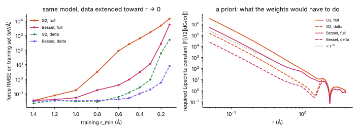

*그림 3-1. 왼쪽: training set force RMSE. 오른쪽: model과 무관하게 데이터와 descriptor만으로 계산한 $L_{req}(r)$. r→0에서 $r^{-3}$ 기울기를 따른다.*

### 21.4 $r_{min}$으로부터 오차 수준을 예측할 수 있나?

**하한은 예측할 수 있다.** 각 데이터 점에서

$$
\varepsilon_F(r)\;\ge\;\max\big(0,\;\lvert F_{ref}(r)\rvert-L\,\lVert dG/dr\rVert\big)
$$

이다. $L$은 두 방법으로 정할 수 있다. 하나는 학습된 모델에서 재는 것(a posteriori)이다. 다른 하나는 "이 정도 가중치 크기까지 허용한다"는 예산으로 두는 것(a priori)이다. 위 demo의 보라색 선이 이 하한이고, 실제 오차(주황)는 그보다 위에 있다.

<!-- demo:lreq -->

### 21.5 일반적인 training data 분포에서 training error를 미리 예측할 수 있나?

부분적으로만 가능하다.

- **가능한 것:** 구조마다 $L_{req}=\lvert F_{ref}\rvert/\lVert\partial G/\partial x\rVert$를 계산하면(다체계에서는 원자별로) 학습 전에 "이 descriptor와 이 크기의 모델로는 못 맞추는 구조"를 골라낼 수 있다. 짧은 거리 구조가 많은 충돌 데이터에서는 이 하한이 오차의 대부분을 설명할 것이다.
- **불가능한 것:** 평형 근처 데이터에서는 $L_{req}$가 작아서 하한이 거의 0이다. 그러면 실제 오차는 다체 복잡도, 데이터 noise, 모델 용량, 최적화가 정한다. 이 논리만으로는 예측되지 않는다.
- 결국 이것은 **descriptor 해상도로 인한 오차 바닥**이다. 전체 training error의 예측식이라기보다 "어디까지가 descriptor 탓인가"를 가르는 진단 도구로 쓰는 것이 맞다.

### 21.6 message passing GNN에도 적용되나?

- **dimer:** 그대로 적용된다(21.1). Bessel basis도 $dB/dr\propto r$이므로 $L_{req}\propto r^{-3}$이다. 다만 $\ell=1/c_{max}$가 작아서 더 안쪽까지 버틴다.
- **다체계:** 충돌 쌍의 radial 입력은 여전히 평탄해진다. 하지만 GNN은 (i) 여러 층의 곱으로 $L$이 커질 수 있고(SiLU는 위로 열려 있음), (ii) 다른 이웃을 거친 경로로도 r 의존성을 만들 수 있다. 그래서 같은 데이터에서 BPNN보다 더 가파르게 맞출 여지가 있다. 그 대가가 18장의 spectator 전파다. 연구실 SevenNet raw ML이 1 Å까지 ZBL을 따라간 것(13장)과 맞는 그림이다.
- 방향 $Y_{lm}$에서 오는 수직 성분은 $\sim1/r$이므로(15.3) 접근 방향의 force에는 기여하지 않는다.

---

## 22. 질문 (2): 유계 basis를 쓰는 이유, 그리고 발산 거동을 쓰는 MLIP

### 22.1 유계 basis를 쓰는 이유

1. **입력 정규화와 조건수:** NN 입력은 표준화해서 넣는다. 1/r 같은 입력은 데이터마다 크기가 수 자릿수씩 달라서 표준화가 무너지고, 최적화가 불안정해진다.
2. **완비성과 cutoff:** Gaussian(ACSF)이나 구면 Bessel $j_0(kr)=\sin(kr)/(kr)$은 $[0,r_c]$ 위의 매끄러운 함수를 전개하는 basis다. Bessel은 공 안에서 경계값 0인 Laplacian의 고유함수라서 서로 직교한다(DimeNet). 경계 $r_c$에서 매끄럽게 0이 되는 envelope와도 잘 맞는다.
3. **발산하는 입력은 발산하는 에너지를 만들지 못한다:** tanh에서는 포화하고, SiLU에서는 입력에 선형으로만 커진다. 1/r 입력을 넣어도 짧은 거리에서는 결국 "큰 상수" 입력이 될 뿐이다.
4. **물리의 분리:** 결합 영역(수 eV)은 ML이, 핵간 반발(수백~수만 eV)은 해석적 항이 맡는 것이 데이터 효율과 외삽 안정성 면에서 낫다.

### 22.2 발산 거동을 직접 쓰는 MLIP

| 모델 | 방식 |
|---|---|
| Coulomb matrix (Rupp et al. 2012), sGDML/GDML | descriptor 자체가 $Z_iZ_j/r_{ij}$ 또는 역거리 $1/r_{ij}$. 분자용, 고정 원자 수 |
| SpookyNet (Unke et al. 2021) | 에너지에 **학습 가능한 ZBL형 핵 반발항**을 더함. ZBL 문헌값으로 초기화하고 양수로 제한하며 $\sum c_k=1$로 묶어 짧은 거리 점근선을 보장 |
| MACE | `pair_repulsion`(ZBL) 옵션과, 짧은 거리 해상도를 높이는 `distance_transform`(Agnesi, 공유 반경 기반) 옵션 |
| NequIP/Allegro, DeePMD(`use_srtab`), ACE(core repulsion) | 명시적 ZBL/pair 항을 더하거나 보간 |
| 최근 연구 | 짧은 거리 경험적 포텐셜을 넣으면 MLIP의 robustness와 학습 효율이 좋아진다는 보고(arXiv:2504.15925) |

### 22.3 수학적으로 "1/r 거동"이 필요할 때 쓰는 basis

- **역거듭제곱(Laurent형)** $r^{-n}$: 점근 차수를 정확히 지정할 수 있지만 조건수가 나쁘다.
- **차폐 쿨롱(Yukawa) 합** $\sum_kc_ke^{-d_kr}/r$: ZBL과 Molière가 바로 이 형태다. $r\to0$에서 $1/r$, 멀리서는 지수 감쇠한다.
- **변수 변환:** $x=1/r$이나 $x=\log r$로 바꾼 뒤 그 변수에 유계 basis를 쓰면 짧은 거리 해상도가 높아진다(MACE의 distance transform이 이런 계열이다).
- **핵심:** 어떤 basis든 발산이 에너지까지 가려면 **비선형 층 밖에서 선형으로** 더해져야 한다. 그래서 실무 답은 "유계 basis + ML"과 "명시적 반발항"의 합이다.

<!-- demo:basis -->

---

## 23. 질문 (3): angular 미분의 "수직 성분"

i와 k를 고정하고 j를 움직인다고 하자. $\cos\theta_{jik}=\hat r_{ij}\cdot\hat r_{ik}$는 $\mathbf r_{ij}$의 **방향**에만 의존한다.

$$
\frac{\partial\cos\theta_{jik}}{\partial\mathbf x_j}=\frac{1}{r_{ij}}\big(\hat r_{ik}-\cos\theta_{jik}\,\hat r_{ij}\big)
$$

- 이 벡터를 $\hat r_{ij}$에 내적하면 $(\cos\theta-\cos\theta)/r_{ij}=0$이다. 즉 **기울기는 전부 $\hat r_{ij}$에 수직**이다.
- 크기는 $\sin\theta/r_{ij}$이다. i를 중심으로 반지름 $r_{ij}$인 원(3D에서는 구) 위에서 j를 **접선 방향**으로 δ만큼 움직이면 호의 길이 = $r\,\Delta\theta$이므로 $\Delta\theta=\delta/r_{ij}$이다. 같은 δ라도 $r_{ij}$가 작을수록 각도가 크게 바뀐다.
- i를 움직이는 경우: $\mathbf r_{ij}=\mathbf x_j-\mathbf x_i$이므로 i를 j 주위의 원 접선 방향으로 움직이면 같은 크기, 반대 부호다(병진 불변성: $\partial/\partial\mathbf x_i=-\partial/\partial\mathbf x_j-\partial/\partial\mathbf x_k$).
- 질문하신 그림("i를 i–j 반지름의 원 위에서 접선 방향으로")이 맞다. 15.3에서 "j를 움직인다"고 쓴 것과 같은 내용이다.

<!-- demo:tangent -->

---

## 24. 질문 (4): DP/ZBL과 SevenNet 방식의 출판, spectator force 억제

### 24.1 출판 여부와 순서

- **DP-ZBL:** H. Wang, X. Guo, L. Zhang, H. Wang, J. Xue, "Deep learning inter-atomic potential model for accurate irradiation damage simulations", *Appl. Phys. Lett.* **114**, 244101 (2019), arXiv:1904.00360. fcc Al의 cascade, 문턱 변위 에너지, 결함에 적용했다. 이후 MoS₂(2020), 3C-SiC(arXiv:2305.19516)에도 쓰였다. 식은 DeePMD-kit 문서의 "Interpolation or combination with a pairwise potential"(`smin_alpha`, `sw_rmin`, `sw_rmax`)에 있다.
- **SevenNet:** SevenNet 논문(Park et al., *JCTC* 2024)에는 ZBL switch가 없는 것으로 안다. checkpoint의 구현은 DP-ZBL의 softmin 방식을 SevenNet에 옮긴 연구실 내부 구현으로 보인다. 정확한 출처는 작성자에게 확인하기 바란다. 순서는 DP-ZBL(2019)이 먼저다.

### 24.2 spectator force는 무엇이 문제인가

- **보존성 문제는 아니다.** 모델 에너지의 정확한 gradient이므로 NVE는 지켜진다.
- **물리 문제다.** $f_i$가 softmin을 통해 원자 i의 **모든 이웃 위치**에 의존하므로, 모델 에너지가 충돌하지 않는 원자의 위치에 비물리적으로 의존한다. 충돌 순간 그 원자들이 수십 eV/Å로 걷어차이면 cascade, 스퍼터링, 결함 생성 통계가 바뀐다.

### 24.3 억제 방법 (같은 E_i^ML, 같은 Si17 경로에서 switch 정의만 바꿔 측정)

| 밀어 넣은 거리 (Å) | 0.8 | 0.7 | 0.6 | 0.5 | 0.4 |
|---|---|---|---|---|---|
| α = 0.104 (checkpoint) | 9.6 | 26.3 | 53.8 | 54.3 | 12.7 |
| α = 0.104, $E_i^{ML}-E_{iso}$ | 10.1 | 27.4 | 55.3 | 55.3 | 12.8 |
| α = 0.05 | 7.1 | 6.0 | 0.86 | 0 | 0 |
| α = 0.03 | 0.71 | 0.35 | 0.02 | 0 | 0 |
| α = 0.02 | 0.03 | 0.01 | 0.001 | 0 | 0 |
| hard min (ACE "zbl" 방식) | 0 | 0 | 0 | 0 | 0 |

(spectator 최대 force, eV/Å. `sw_variants.py`)

- **고립 원자 기준 보정은 효과가 거의 없다.** 이 구간의 $E_i^{ML}$(25–75 eV)은 기준 이동이 아니라 학습된 반발이기 때문이다.
- **α를 줄이면 거의 사라진다.** spectator k의 softmin 가중치가 $e^{-(\bar r_k-\bar r_{min})/\alpha}$로 지수적으로 작아진다.
- **hard min(가장 가까운 이웃 거리)을 쓰면 정확히 0이다.** 대신 가장 가까운 이웃이 바뀌는 순간 기울기가 불연속이다. 두 이웃이 동시에 window 안에 있을 때만 생기는 드문 경우다.
- **"추가 항으로 억제"에 대해:** $-E_i^{ML}\nabla f_i$는 구조에서 나오는 항이라 loss의 penalty로 없앨 수는 없다. 대신 switch window 안에서 **$E_i^{ML}$ 자체를 작게** 만들 수 있다. 예를 들면 ML 안에서 pair baseline을 빼서 학습하거나(delta), window 안의 데이터로 ML 에너지를 묶는 것이다. 근본 해법은 bond 단위 switch다(25장).
- α를 바꾸면 모델 에너지가 달라지므로 **재학습이 필요하다.** 위 표는 switch 항만의 추정치다.

<!-- demo:swvar -->

---

## 25. 질문 (5): ACE core repulsion, 그리고 bond 단위 switch의 상한 문제

### 25.1 ML-PACE(LAMMPS `pair_style pace`) 소스에서 확인한 내용

`ICAMS/lammps-user-pace`의 `ML-PACE/ace/ace_b_evaluator.cpp`와 `ace-evaluator/ace_radial.cpp`를 읽었다. inner cutoff 방식은 세 가지다.

1. **기본(density) 방식:** core 밀도 $\rho^{core}_i=\sum_jA e^{-\lambda r_{ij}^2}/r_{ij}\cdot\text{env}(r_{ij})$를 쓴다. $E_i=f(\rho^{core}_i)\,E_i^{ACE}+\rho^{core}_i$이고, $f$는 `rho_core_cut`, `drho_core_cut`로 정한다. atom 단위 switch지만 switch 변수가 **강하게 감쇠하는 반발 pair의 합**이라 가장 가까운 쌍이 지배한다.
2. **`inner_cutoff_type: distance` — bond 단위:** ACE의 radial basis에 $g_n(r)\to g_n(r)\,[1-f_{in}(r)]$를 곱한다(`r_in`, `delta_in`). 그래서 inner 안쪽의 이웃은 **descriptor에서 매끄럽게 사라진다.** core repulsion $Ae^{-\lambda r^2}/r$은 반대로 $f_{in}(r)$을 곱해서 inner 안쪽에서만 켜진다. 17.4의 해법 C가 바로 이것이다.
3. **`inner_cutoff_type: zbl` — 가장 가까운 이웃 기준 atom switch:** $\rho^{core}_i=\sum_jV_{ZBL}(r_{ij})$이고(ZBL은 outer cutoff까지 "full force"), $E_i=f\,E_i^{ACE}+(1-f)\,\rho^{core}_i$이다. $f$는 **가장 가까운 이웃까지의 거리 $r_{min,i}$**(종 쌍별 inner 값으로 이동)의 다항식 cutoff다. switch의 미분은 가장 가까운 이웃 $j_{min}$에만 걸리므로 **spectator force가 없다.** LAMMPS에서는 원자별 core-repulsion 비율을 `fix pair … pace corerep`으로 출력할 수 있다.

pacemaker에는 ZBL core repulsion을 데이터로부터 맞추는 `pace_corerep` 도구가 있다. FAQ는 짧은 거리 데이터가 없을 때 core repulsion을 권한다. 문서 버전에 따라 transition 구간 표기($[r_{in}-\delta,r_{in}]$ vs $[r_{in},r_{in}+\delta]$)가 다르므로, 쓰는 버전의 소스를 확인하는 것이 안전하다.

### 25.2 bond 단위로 끄면 상한(학습 가능성) 문제에 걸리나?

**걸리지 않는다.** 이유는 다음과 같다.

- 21장의 문제는 "NN이 descriptor를 통해 $1/r^2$ force를 만들어야 하는데 $dG/dr\propto r$이라 불가능"이었다. bond 단위 switch에서는 inner 안쪽의 쌍이 **NN 입력에서 빠지고**, 발산은 명시적 pair 항(ZBL)이 **선형으로** 맡는다(22.3의 조건).
- window 안에서 NN이 맞출 것은 residual $E_{ref}-V_{ZBL}$이고, 입력 쪽 r 의존성은 $g_n(r)[1-f_{in}(r)]$로 유계·매끄럽다. 그러므로 $L_{req}$가 발산하지 않는다.
- message passing에서는 그 edge의 message 자체가 사라지므로 18장의 spectator 전파도 근원에서 막힌다.

**대가와 주의점:**

- inner 안쪽에서는 ML이 그 쌍을 보지 못하므로 **ZBL의 오차(수~십여 %)를 보정할 수 없다.** $r_{in}$은 ZBL이 충분히 맞는 거리(대략 ≲1 Å, 2·4장)에 두거나, ZBL 대신 DFT dimer에 맞춘 pair를 쓴다.
- 그 상태에서 ML 에너지는 "그 이웃이 없는 환경"의 값이 된다. 다른 결합은 유지되므로 대체로 합리적이다.
- **구조에 따라 쉬운 정도가 다르다.** ACE/MACE처럼 다체 basis가 단일 이웃 함수의 곱인 구조에서는 radial 함수 하나에 인자를 곱하면 그 이웃이 모든 차수에서 사라진다. 반면 ACSF G4는 $f_c(r_{jk})$처럼 이웃끼리의 거리가 직접 들어가므로 $r_{jk}$ 다리에도 inner 인자를 넣어야 한다.
- descriptor가 바뀌므로 **재학습이 필요하다.**

---

## 참고 문헌

- J. F. Ziegler, J. P. Biersack, U. Littmark, *The Stopping and Range of Ions in Matter*, Vol. 1, Pergamon (1985).
- K. Nordlund, N. Runeberg, D. Sundholm, "Repulsive interatomic potentials calculated using Hartree-Fock and density-functional theory methods", *Nucl. Instrum. Methods B* **132**, 45 (1997).
- J. Tersoff, "New empirical approach for the structure and energy of covalent systems", *Phys. Rev. B* **37**, 6991 (1988).
- J. Byggmästar, A. Hamedani, K. Nordlund, F. Djurabekova, "Machine-learning interatomic potential for radiation damage and defects in tungsten", *Phys. Rev. B* **100**, 144105 (2019).
- E. Hairer, C. Lubich, G. Wanner, *Geometric Numerical Integration*, Springer (2006). symplectic 적분기와 에너지 보존.
- LAMMPS 문서: `pair_style zbl`, `pair_style lj/gromacs`, `pair_style tersoff/zbl`.
- J. Behler, M. Parrinello, "Generalized neural-network representation of high-dimensional potential-energy surfaces", *Phys. Rev. Lett.* **98**, 146401 (2007).
- J. Behler, "Atom-centered symmetry functions for constructing high-dimensional neural network potentials", *J. Chem. Phys.* **134**, 074106 (2011).
- B. Deng et al., "Overcoming systematic softening in universal machine learning interatomic potentials by fine-tuning" (arXiv 2024; *npj Comput. Mater.* 2025).
- J. Klicpera (Gasteiger), J. Groß, S. Günnemann, "Directional message passing for molecular graphs" (DimeNet), ICLR (2020). Bessel radial basis + polynomial envelope.
- S. Batzner et al., "E(3)-equivariant graph neural networks for data-efficient and accurate interatomic potentials" (NequIP), *Nat. Commun.* **13**, 2453 (2022).
- Y. Park et al., "Scalable parallel algorithm for graph neural network interatomic potentials in molecular dynamics simulations" (SevenNet), *J. Chem. Theory Comput.* **20**, 4857 (2024).
- DeePMD-kit 문서: DP/ZBL 모델 (`sw_rmin`, `sw_rmax`, `smin_alpha`).
- H. Wang, X. Guo, L. Zhang, H. Wang, J. Xue, "Deep learning inter-atomic potential model for accurate irradiation damage simulations", *Appl. Phys. Lett.* **114**, 244101 (2019), arXiv:1904.00360.
- O. T. Unke et al., "SpookyNet: Learning force fields with electronic degrees of freedom and nonlocal effects", *Nat. Commun.* **12**, 7273 (2021), arXiv:2105.00304.
- M. Rupp, A. Tkatchenko, K.-R. Müller, O. A. von Lilienfeld, "Fast and accurate modeling of molecular atomization energies with machine learning", *Phys. Rev. Lett.* **108**, 058301 (2012).
- S. Chmiela et al., "Towards exact molecular dynamics simulations with machine-learned force fields" (sGDML), *Nat. Commun.* **9**, 3887 (2018).
- Y. Lysogorskiy et al., "Performant implementation of the atomic cluster expansion (PACE)", *npj Comput. Mater.* **7**, 97 (2021); ML-PACE 소스 `ICAMS/lammps-user-pace`; pacemaker 문서(Input file, FAQ, `pace_corerep`).
- "Improving robustness and training efficiency of machine-learned potentials by incorporating short-range empirical potentials", arXiv:2504.15925 (2025).
